# Tu primera entidad en este framework

Recorrido para agregar tu propia entidad a este proyecto, desde un clon recién hecho hasta tenerla
funcionando con tests. Está escrito para seguirse de arriba abajo, en orden, sin saltear pasos.

Al terminar tendrás una entidad `notas` que lista, crea, valida y responde por identificador, y
una suite mínima que reemplaza las comprobaciones que fuiste haciendo a mano.

## Prerrequisitos

Necesitas:

- PHP 8.4.1 o superior con `pdo_sqlite`, `mbstring` y `sqlite3`.
- Composer 2.
- Un navegador.
- `curl` (opcional). Todas las comprobaciones se pueden hacer desde el navegador; `curl` sólo sirve
  si prefieres ver los cuerpos crudos.

**Lo que este recorrido no enseña**: instalar PHP, Composer ni Termux; el contenedor de dependencias;
los middlewares; la autenticación; los assets y el sistema visual; el despliegue. Todo eso está en
`docs/guia-stack-php-termux.md`. Aquí se da por hecho que el framework ya arranca.

## Cómo leer cada paso

Cada paso tiene la misma forma, y conviene respetarla:

- **Objetivo**: la acción concreta.
- **Estado de partida**: qué tiene que estar hecho. Si falta, el paso dice cómo volver.
- **Acción**: el archivo y el código, o el comando.
- **Archivo**: cuando el cambio es un fragmento, indica la ruta y el método o bloque exacto.
- **Antes/Después**: cuando hay que insertar o sustituir, muestra las líneas vecinas para que sepas
  dónde va el cambio. Las líneas `// …` y `{# … #}` marcan código que no cambia.
- **Comprobación**: qué ejecutar y **qué debes ver**, escrito antes de que lo veas.
- **Falla si**: la señal concreta de que el paso no quedó.
- **Qué no prueba**: el límite de esa comprobación.
- **Pieza**: cuando aparece algo reutilizable, qué resuelve, cuándo usarlo, qué evita y cómo se haría
  sin él.

Si una comprobación no da lo esperado, no sigas: el paso siguiente asume que este quedó bien.

## Índice

1. [Arrancar la app hasta tener sesión](#1-arrancar-la-app-hasta-tener-sesión)
2. [La migración de `notas`](#2-la-migración-de-notas)
3. [El modelo `Nota`](#3-el-modelo-nota)
4. [Registrar la entidad en las rutas y en el menú](#4-registrar-la-entidad-en-las-rutas-y-en-el-menú)
5. [La primera ruta: JSON verificable](#5-la-primera-ruta-json-verificable)
6. [La pantalla del listado: del HTML crudo al shell](#6-la-pantalla-del-listado-del-html-crudo-al-shell)
7. [El alta: del formulario crudo al modal del proyecto](#7-el-alta-del-formulario-crudo-al-modal-del-proyecto)
8. [Las acciones por fila: del icono mudo al botón accesible](#8-las-acciones-por-fila-del-icono-mudo-al-botón-accesible)
9. [Editar en el mismo modal](#9-editar-en-el-mismo-modal)
10. [Borrar: del confirm del navegador al diálogo del proyecto](#10-borrar-del-confirm-del-navegador-al-diálogo-del-proyecto)
11. [Tests que reemplazan lo que hacías a mano](#11-tests-que-reemplazan-lo-que-hacías-a-mano)
12. [Extraer la lista y el encabezado a componentes](#12-extraer-la-lista-y-el-encabezado-a-componentes)
13. [Paginación del servidor](#13-paginación-del-servidor)
14. [Repetir el patrón con otra entidad](#14-repetir-el-patrón-con-otra-entidad)

Cada pieza de UI aparece dos veces: primero en su versión básica —HTML crudo, `<dialog>` nativo,
`confirm()` del navegador, iconos sin nombre— y después sustituida por el componente del proyecto, con
lo que se gana y lo que se evita. Los pasos 1 a 11 dejan la entidad completa y probada; el 12 extrae
la lista y el encabezado a componentes reusables, el 13 hace que la lista siga siendo usable cuando
crece, y el 14 te deja el patrón para otra entidad tuya.

**¿Quieres ver el resultado antes de empezar?** El mismo recorrido existe como demo instalable:
`composer demo:notas:install` (se quita con `composer demo:notas:remove`). Sirve para comparar, no para
aprender: el demo te da el código hecho, el recorrido te hace escribirlo. La diferencia concreta es de
nombres —el demo vive en `App\Notas\…` porque tiene que ser removible; el recorrido usa
`App\Models\Nota` y `App\Http\Controllers\NotaController`, que es donde va una entidad tuya—. El
comportamiento y las vistas son los mismos.

Míralo **antes** de empezar, en un clon limpio: el demo y tu `notas` son la misma entidad —misma tabla,
misma clase de migración— y no pueden estar instalados a la vez. Si ya seguiste el recorrido, cópialo
para comparar en lugar de instalarlo encima.

## 1. Arrancar la app hasta tener sesión

**Objetivo**: pasar de un clon sin configurar a una app respondiendo, con sesión iniciada.

**Estado de partida**: el repositorio clonado, terminal en la raíz del proyecto.

El clon no arranca: falta `.env`, faltan las dependencias y falta la base. Antes de escribir la primera
línea de la entidad, el proyecto tiene que quedar en un estado comprobable —una app que responde, un
esquema aplicado y una sesión abierta—, porque desde el paso 2 cada comprobación se hace con la app
corriendo y el usuario adentro.

**Acción**:

```bash
cp .env.example .env
composer install:termux
composer dump-autoload -o
composer migrate
```

Después siembra el administrador. Las credenciales van en `.env` —está en `.gitignore`, así que no se
commitea—: descomenta las dos líneas que el archivo ya trae y complétalas.

```dotenv
ADMIN_EMAIL=dev@ejemplo.com
ADMIN_PASSWORD=una-clave-de-8-o-mas
```

```bash
vendor/bin/phinx seed:run -s DatabaseSeeder
```

¿Por qué en `.env` y no en el comando? Porque las vas a necesitar otra vez —después de
`phinx rollback -t 0`, o al reinstalar un demo— y así no quedan en el historial del shell. La
contraseña tiene que tener 8 caracteres o más.

Si prefieres que no toquen el disco, el seeder también lee el entorno real:

```bash
ADMIN_EMAIL=dev@ejemplo.com ADMIN_PASSWORD=una-clave-de-8-o-mas \
  vendor/bin/phinx seed:run -s DatabaseSeeder
```

> Esa forma multilínea es de bash: en PowerShell no funciona (usa `$env:ADMIN_EMAIL = "..."` antes del
> comando). Y mientras corre el proceso, las variables inline son visibles en `ps`. Si están en los dos
> lados, gana el entorno real.

Y levanta el servidor de desarrollo:

```bash
php -S 127.0.0.1:8080 -t public
```

`127.0.0.1` y no `0.0.0.0`: con `0.0.0.0` el servidor escucha en todas las interfaces y la app sale a
la red local, donde el administrador que acabas de sembrar tiene acceso a todo. Si necesitas verla
desde otro dispositivo, hay un túnel con TLS para eso; el binding abierto no es el atajo.

**Comprobación**: abre `http://localhost:8080/login` en el navegador. Tienes que ver el formulario de
acceso. Entra con el email y la contraseña que sembraste: después del login el navegador te lleva a la
portada y en el pie del sidebar aparece tu usuario, con tu email debajo.

**Falla si**:

- `phinx seed:run` aborta pidiendo `ADMIN_EMAIL` y `ADMIN_PASSWORD`: no están en `.env` —revisa que las
  dos líneas no sigan empezando con `#`— o la contraseña tiene menos de 8 caracteres.
- El login vuelve al formulario con el aviso «Credenciales inválidas.»: el email o la contraseña no
  coinciden con el admin que sembraste. El mensaje es genérico a propósito —no dice cuál de los dos
  falló, para no revelar qué cuentas existen—, así que revisa los dos.
- `php -S` arranca pero el navegador da 404: estás abriendo la ruta sin `-t public`, o el servidor
  corre en otro directorio.

**Qué no prueba**: que el resto de la app funcione. Prueba que hay conexión a la base, que las
migraciones corrieron y que la sesión se crea. No prueba nada de tu entidad, que todavía no existe.

> Ya existe un administrador con acceso a todo. Si vas a exponer esta app fuera de tu máquina, ese
> usuario es un problema pendiente, no parte del recorrido.

**Qué ganaste**: la app arranca, la base tiene el esquema aplicado y entras con tu usuario. Y mira el
costo: nada de eso sabe que vas a crear notas. No hay tabla, ni modelo, ni ruta, así que la entidad
empieza en el paso siguiente.

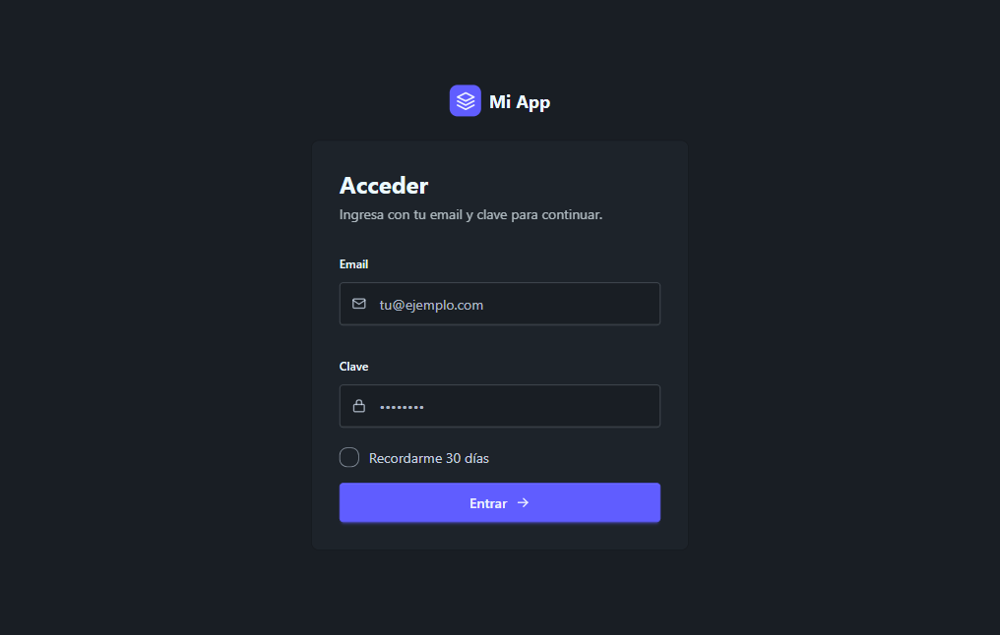

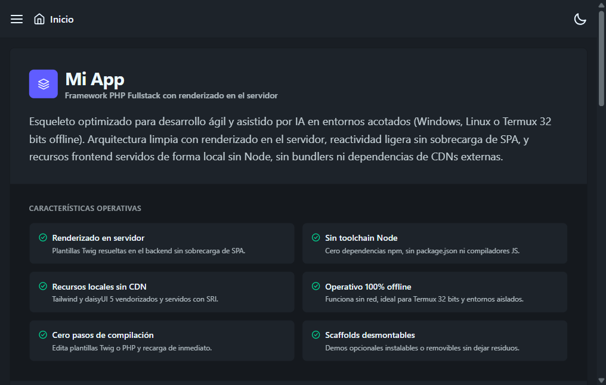

---

## 2. La migración de `notas`

**Objetivo**: crear la tabla. Sin tabla, el modelo no puede guardar nada.

**Estado de partida**: el paso 1 hecho; `composer migrate` corre sin errores.

La app responde, pero no tiene dónde guardar una nota: la primera escritura va a terminar en `no such
table`. En este proyecto el esquema se escribe en migraciones y no a mano en la base, así que el primer
archivo de la entidad es el que crea la tabla y el que permite deshacerla.

**Acción**: mira qué números de migración están libres:

```bash
ls database/migrations/
```

Vas a ver archivos como `002_create_users_table.php` y `003_create_remember_tokens.php`. La
convención del proyecto es **numeración secuencial**, no timestamps, así que toma el siguiente
número libre. Si la última es `010_...`, tu archivo es `011_create_notas_table.php`:

```php
<?php

declare(strict_types=1);

use Phinx\Migration\AbstractMigration;

final class CreateNotasTable extends AbstractMigration
{
    public function change(): void
    {
        $this->table('notas')
            ->addColumn('titulo', 'string', ['limit' => 120])
            ->addColumn('cuerpo', 'text', ['null' => true])
            ->addTimestamps()
            ->create();
    }
}
```

```bash
vendor/bin/phinx migrate
```

**Phinx tiene un generador** y conviene conocerlo: `vendor/bin/phinx create CreateNotasTable` escribe
`20261112180349_create_notas_table.php` con el esqueleto y el `change()` vacío. Sirve, pero su versión
es un **timestamp**, y este proyecto usa numeración secuencial porque los timestamps saturan el entero
de 32 bits en bases grandes. Así que, si lo usas, renombralo a `011_create_notas_table.php`: la versión
sale del prefijo del archivo y el nombre de la clase no cambia.

> **`007` y `008` están tomados** por las migraciones de los demos de notas y contactos. No son
> números libres aunque no veas esos archivos en `database/migrations/`: viven en
> `framework/scaffolds/*/database/migrations/<demo>/` y el instalador del demo los copia con esa
> versión. Si tu entidad usa uno de esos números, `composer demo:notas:install` aborta después con una
> colisión que no esperabas.

Por eso el recorrido crea el archivo a mano: son veinte líneas, y el nombre —que es lo que Phinx toma
como versión— queda bien desde el principio. Si algún día armas un demo instalable, el generador acepta
`--path` para escribir dentro de `database/migrations/<demo>/`.

**Comprobación**: ejecuta `vendor/bin/phinx status` (o vuelve a `composer migrate`). Tienes que ver tu
migración listada como aplicada, sin pendientes.

**Falla si**:

- Phinx dice que ya existe una migración con ese número: alguien usó ese número mientras mirabas.
  Elige el siguiente libre, nunca reutilices uno.
- El error menciona `notas` ya existente: la tabla quedó de un intento anterior. `vendor/bin/phinx
  rollback -t 0` la baja, y vuelves a subir.

**Qué no prueba**: que el modelo use esta tabla ni que los campos alcancen. La migración sólo prueba
que el esquema se puede crear y revertir.

> **Por qué `titulo` no es `NOT NULL`**: si miras la tabla vas a ver `VARCHAR(120)` que acepta nulos.
> La obligatoriedad la impone el validador (paso 7), no la base. Es la convención del proyecto: el
> mensaje de error lo da la capa de validación, que es la que puede explicarle al usuario qué
> corregir.

**Qué ganaste**: la tabla `notas` existe, con sus columnas y su marcha atrás —`phinx rollback` la baja
sin dejar restos—. Lo que todavía no existe es una forma de leerla desde PHP; escribir SQL a mano en cada
controlador es justo lo que el proyecto evita.

**Pieza — migraciones Phinx con numeración secuencial**: resuelven el versionado del esquema sin
depender de un ORM que lo adivine. Usalas siempre que cambie el esquema. Evitan el problema de los
timestamps, que saturan enteros de 32 bits en bases grandes. Sin esta pieza tendrías que aplicar SQL
a mano y acordarte del orden; el proyecto ya tiene el mecanismo, sólo hay que escribir el archivo.

---

## 3. El modelo `Nota`

**Objetivo**: poder leer y escribir la tabla desde PHP sin SQL escrito a mano.

**Estado de partida**: paso 2 hecho, la tabla existe.

Con la tabla creada, el problema pasa a ser desde dónde escribirla. Un controlador que arma la sentencia
a mano repite el nombre de la tabla, el orden de las columnas y el escapado en cada acción; el proyecto
usa una clase por tabla, y esa clase queda como el único lugar que conoce `notas`.

**Acción**: crea `app/Models/Nota.php`:

```php
<?php

declare(strict_types=1);

namespace App\Models;

use Illuminate\Database\Eloquent\Model;

/**
 * @property int $id
 * @property string $titulo
 * @property string|null $cuerpo
 * @property \Illuminate\Support\Carbon $created_at
 * @property \Illuminate\Support\Carbon $updated_at
 * @method static Nota|null find(int|string $id)
 * @method static Nota create(array<string, mixed> $attributes = [])
 * @method static \Illuminate\Database\Eloquent\Builder<Nota> orderByDesc(string $column)
 */
class Nota extends Model
{
    protected $table = 'notas';

    protected $fillable = ['titulo', 'cuerpo'];
}
```

**Comprobación**:

```bash
composer lint
```

Esperado: un archivo **más** que antes de crear el modelo. Corre `composer lint` **antes** de crearlo y
anota el total: en un clon limpio dice `Lint OK (79 archivos)`, y después de este archivo, `80`.

**Falla si**:

- El lint reporta un error de sintaxis: revisa llaves y `;`.
- El total de archivos no subió respecto de la corrida anterior: el archivo no está donde el lint
  mira. Anota el total antes de crearlo y compara.

**Qué no prueba**: que el modelo conecte con la tabla. El lint sólo verifica sintaxis; la prueba real
llega en el paso 7, cuando creas la primera nota. Si el modelo apunta a una tabla inexistente, el
error aparece ahí, con `no such table: notas`.

> El modelo sí se puede comprobar desde la terminal: `php -r 'require "bootstrap/app.php"; echo
> App\Models\Nota::query()->count(), PHP_EOL;'` imprime `0` sin avisos.

**Qué ganaste**: `Nota::query()` alcanza la tabla y el resto de los pasos puede leer y escribir sin SQL
escrito a mano. El costo es que todavía nadie la usa: no hay ruta que la llame, así que el modelo existe
y no se ve en ninguna pantalla.

**Pieza — Eloquent standalone**: resuelve el acceso a datos con un modelo por tabla. Úsalo para
toda lectura y escritura; el proyecto no escribe SQL a mano en los controladores. Evita el SQL
disperso por las vistas y los controladores. Sin él tendrías que preparar sentencias y mapear filas a
mano en cada operación.

---

## 4. Registrar la entidad en las rutas y en el menú

**Objetivo**: que el framework sepa que existe `/notas`, comprobarlo, y que la app ofrezca el camino
para llegar sin escribir la URL a mano.

**Estado de partida**: pasos 1 a 3 hechos.

### 4.1 Un archivo de rutas por entidad

El modelo ya sabe leer la tabla, pero la app no tiene por dónde pedirla: `/notas` no existe para el
framework. Este paso se lo dice, en un archivo propio en lugar de tocar el arranque de la app, para que
agregar una entidad no obligue a editar infraestructura compartida.

El archivo tiene una sola idea: un grupo bajo `/notas` con la protección aplicada al grupo, y adentro una
ruta que devuelve un texto fijo. Con eso alcanza para saber si el registro funciona.

**Acción**: el archivo de rutas de tu entidad, `routes/notas.php`:

```php
<?php

declare(strict_types=1);

use Framework\Http\Middleware\RequireAuthMiddleware;
use Psr\Http\Message\ResponseInterface as Response;
use Psr\Http\Message\ServerRequestInterface as Request;
use Slim\App;

return function (App $app) {
    $app->group('/notas', function ($group) {
        $group->get('', function (Request $request, Response $response): Response {
            $response->getBody()->write('notas: ruta registrada');

            return $response->withHeader('Content-Type', 'text/plain; charset=utf-8');
        });
    })->add(RequireAuthMiddleware::class);
};
```

**Y nada más.** No hay que registrar el archivo en ningún lado: el arranque de la app carga `web.php`
primero y después el resto de `routes/*.php` por orden alfabético. Dejar el archivo en `routes/` es todo
lo que hace falta, y por eso agregar una entidad no toca `bootstrap/app.php`.

La ruta atiende un **closure**, no un controlador. Es un andamio: sirve para comprobar el registro sin
escribir todavía la clase, y en el paso 5 lo reemplaza `NotaController`. El `POST` no se registra hasta
el paso 7, cuando exista la acción `store` que lo atiende: una ruta sin acción es una promesa que el
framework no puede cumplir.

**Comprobación**: dos visitas a `http://localhost:8080/notas`, y ninguna debería darte un error.

1. **Sin sesión** —una ventana privada, o cierra sesión antes—. Tienes que volver al login: una
   **redirección 303** a `/login`.
2. **Con sesión**. Tienes que ver el texto, sin HTML alrededor:

   ```
   notas: ruta registrada
   ```

El 303 prueba que la ruta existe y que la protección está puesta: una ruta inexistente devuelve 404, no
redirige. El 200 con el texto prueba que la petición llegó hasta tu closure.

**Por qué no esperar un error**: un 500 también aparece cuando el problema está en otro lado —el `.env`,
la base, una migración sin correr—, así que no distingue «la ruta quedó registrada» de «el proyecto está
roto». Un 200 con un texto que solo puede salir de esta ruta no se confunde con nada.

**Falla si**:

- Ves la **página 404 del framework**: el archivo no está directamente en `routes/`, no termina en
  `.php`, o su `return function (App $app) { … };` no está devolviendo el closure.
- Ves el login en vez del texto aunque hayas iniciado sesión: la sesión se perdió. Vuelve al paso 1.
- Llegas al texto por otra URL: el patrón del `group('/notas')` no coincide con la que estás abriendo.

**Qué no prueba**: que la ruta haga algo útil. Prueba el registro y la protección; el controlador llega
en el paso 5.

**Convenciones que este paso deja claras**:

- **El nombre del archivo no importa.** El arranque hace `glob('routes/*.php')` y los carga todos. Se
  llama `notas.php` por legibilidad —un archivo por entidad—, no porque el framework lo busque por
  nombre: un `routes/mi-entidad.php` responde igual.
- **La ubicación sí importa.** Sólo el primer nivel de `routes/`: un archivo en `routes/sub/` nunca se
  carga, y su ruta da 404 sin ningún aviso.
- **El orden de carga es alfabético**, con `web.php` forzado primero. Importa sólo si dos archivos
  declaran la misma ruta y método.
- **Cada archivo devuelve un closure** que recibe la app: `return function (App $app) { … };`. Si no
  devuelve uno, el archivo se carga y no registra nada, sin error.

**Qué ganaste**: `/notas` existe, responde un texto que sólo puede salir de esta ruta y exige sesión, así
que el registro quedó comprobado sin haber escrito el controlador. Falta lo demás: no hay pantalla, ni
datos, ni un camino para llegar sin teclear la URL.

**Pieza — un archivo de rutas por entidad, cargado por convención**: resuelve la separación entre «la
ruta existe» y «el arranque de la app». Cada entidad tiene su archivo y el arranque los levanta solo.
Evita meter rutas de dominio dentro de `bootstrap/app.php`, que es arranque del framework y no tuyo.
Sin esta pieza tendrías todas las rutas del proyecto en un archivo que crece sin límite.

**Pieza — `RequireAuthMiddleware`**: resuelve la puerta de entrada a las rutas privadas. Se aplica al
grupo, no ruta por ruta, para que no se te olvide ninguna. Evita el clásico «me olvidé de proteger el
POST». Sin él, `curl` podría crear filas sin sesión.


---

### 4.2 El menú: llegar sin escribir la URL

Con la ruta respondiendo, llegas a `/notas` escribiendo la URL a mano. Eso sirve para probar y no para
usar: quien entra a la app no tiene por dónde descubrir la pantalla. El menú lateral es la mejora que
ahorra ese paso, y se arma por convención, igual que las rutas: cada módulo deja su entrada en
`config/navigation/`.

**Acción**: primero el directorio, que no viene en el clon:

```bash
mkdir -p config/navigation
```

La carpeta no tiene archivos versionados en el repo: la crea la instalación de un demo, y al quitarlo
se borra si queda vacía. No está en `.gitignore`, así que la entrada que agregues se versiona junto
con tu entidad.

Ahora el archivo, `config/navigation/notas.php`:

```php
<?php

declare(strict_types=1);

return [
    'label'    => 'Notas',
    'href'     => '/notas',
    'icon'     => 'list',
    'key'      => 'notas',
    'position' => 30,
];
```

`key` es lo que el sidebar compara con el `active` de la página para marcarla; `position` ordena las
entradas (Inicio es 0; Tareas 10, Contactos 20, Notas 30).

**Comprobación**: con sesión iniciada, recarga cualquier página. En el menú lateral aparece «Notas»
debajo de «Inicio», y al tocarlo llegas a `/notas`, que responde el texto de prueba del paso anterior.

**Falla si**:

- No aparece: falta el directorio `config/navigation/`, el archivo no termina en `.php`, o le falta
  alguna de las claves `label`, `href` o `key`.
- Aparece y al tocarlo da 404: `href` no coincide con el grupo de tu archivo de rutas.

**Qué no prueba**: que la pantalla exista. Probaste que la ruta responde (4.1) y que hay un camino
hasta ella (4.2); lo que se ve al llegar es el paso 6.

**Convenciones que este paso deja claras**:

- **El nombre del archivo no importa.** El contenedor hace `glob('config/navigation/*.php')` y lee cada
  uno; la entrada se identifica por su clave `key`, no por el nombre del archivo. Se llama `notas.php`
  porque un archivo por módulo se lee mejor.
- **La `key` sí importa**: es el valor que la página declara como `active` para que el sidebar la marque.
- **`position` ordena**, no el orden alfabético ni el nombre del archivo.

**Qué ganaste**: la pantalla tiene puerta: el menú la ofrece en cualquier página y se arma solo, sin
editar `sidebar.twig`. Lo que sigue sin existir es la pantalla misma: el capítulo 5 deja el controlador,
y el 6 la vista.

**Pieza — convención de navegación**: cada módulo declara su entrada en `config/navigation/<módulo>.php`
y el contenedor las descubre. Evita editar `sidebar.twig` y `container.php` para cada entidad —que
además están copiados en la documentación del framework y obligarían a `docs:sync`—. Agregar una
entidad es dejar su archivo; quitarla es borrarlo.

> Si tu entidad es además un **demo instalable**, el mismo archivo lleva `summary` (el texto de la
> tarjeta en la portada) y el nombre del demo, y la portada la lista con su estado *Instalado* u
> *Opcional*. Para una entidad de tu app alcanza con `label`, `href`, `icon`, `key` y `position`.

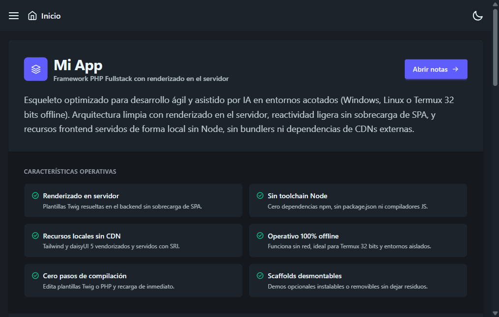

---

## 5. La primera ruta: JSON verificable

**Objetivo**: comprobar que tu ruta responde algo, antes de involucrar vistas y formularios.

**Estado de partida**: paso 4 hecho; `/notas` responde el texto de prueba `notas: ruta registrada`.

Ese texto prueba una sola cosa: que la ruta está registrada. No dice si el request llega, si el contenedor
construye la clase ni si la respuesta sale bien formada. Este paso cambia el closure por un controlador y
devuelve un JSON que se compara cadena contra cadena, antes de que una vista meta HTML en el medio.

La recompensa es de diagnóstico: si el JSON sale, el cableado está bien y cualquier problema que aparezca
después es de la vista; si no sale, no tiene sentido tocar Twig todavía. Esa distinción es la que te
ahorra buscar en el lugar equivocado.

**Acción**: ahora el controlador. Crea `app/Http/Controllers/NotaController.php` con una sola acción:

```php
<?php

declare(strict_types=1);

namespace App\Http\Controllers;

use Framework\Http\Controller;
use Psr\Http\Message\ResponseInterface as Response;
use Psr\Http\Message\ServerRequestInterface as Request;

final class NotaController extends Controller
{
    public function index(Request $request, Response $response): Response
    {
        $cuerpo = ['status' => 'ok', 'recurso' => 'notas'];

        $response->getBody()->write((string) json_encode($cuerpo, JSON_UNESCAPED_UNICODE));

        return $response->withHeader('Content-Type', 'application/json');
    }
}
```

Y en `routes/notas.php`, el closure del paso 4 se reemplaza por la acción. El archivo queda así, y el
`use` del controlador es lo único nuevo:

```php
<?php

declare(strict_types=1);

use App\Http\Controllers\NotaController;
use Framework\Http\Middleware\RequireAuthMiddleware;
use Slim\App;

return function (App $app) {
    $app->group('/notas', function ($group) {
        $group->get('', [NotaController::class, 'index']);
    })->add(RequireAuthMiddleware::class);
};
```

**Convenciones que este paso deja claras**:

- **El namespace es la ruta del archivo.** El `composer.json` mapea `App\` a `app/`, así que
  `App\Http\Controllers\NotaController` sólo puede vivir en `app/Http/Controllers/NotaController.php`.
  Si mueves el archivo, mueves el namespace.
- **El nombre del archivo es el nombre de la clase**, mayúscula incluida. En Linux y en Termux el
  sistema de archivos distingue mayúsculas: `notacontroller.php` no carga.
- **Los subdirectorios sí funcionan aquí**, al revés que en `routes/`: `App\Http\Controllers\Auth\AuthController`
  vive en `app/Http/Controllers/Auth/AuthController.php`. El namespace acompaña la profundidad.
- **La ruta apunta a la clase, no al archivo**: `[NotaController::class, 'index']` es un método de
  instancia, y el contenedor construye la clase en cada petición.

**Comprobación**: con sesión iniciada, abre `http://localhost:8080/notas` en el navegador. Tienes que
ver exactamente:

```json
{"status":"ok","recurso":"notas"}
```

**Falla si**:

- Ves `{"status":"ok","recurso":"notas"}` pero el login te lo pidió de nuevo: normal, la ruta está
  protegida; inicia sesión y vuelve.
- Ves HTML: el navegador está mostrando otra ruta; revisa la URL.
- Ves un error de PHP: el `namespace` o el nombre de la clase no coinciden con la ruta del archivo.

**Qué no prueba**: nada sobre datos ni sobre interfaz. Prueba el camino completo request → ruta →
controlador → respuesta, que es lo que se rompe primero cuando algo está mal cableado.

> Esta primera comprobación es JSON a propósito: no hay HTML que interpretar, así que la comparación
> es cadena contra cadena. Cuando en el paso 6 entre una vista, la comprobación pasa a ser visual y
> menos precisa.

**Qué ganaste**: el camino request → ruta → controlador → respuesta funciona, y lo puedes verificar sin
interpretar nada. El costo es que no hay pantalla ni datos: el controlador devuelve una constante. Lo que
sigue es darle una vista.

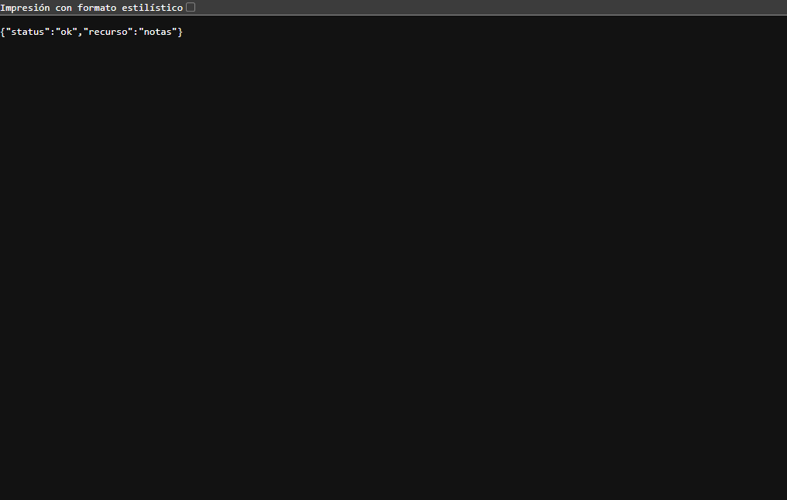

---

## 6. La pantalla del listado: del HTML crudo al shell

**Objetivo**: llegar a la pantalla del listado entendiendo qué aporta cada pieza, empezando por lo
básico y sin mezclar capas.

**Estado de partida**: paso 5 hecho; `/notas` devuelve el JSON de prueba y el menú ya muestra la
entrada. Ahora `index()` deja de devolver JSON.

### 6.1 Primero, un HTML mínimo desde el controlador

El JSON se compara de un vistazo, pero no es una pantalla: no tiene `<head>`, ni tema, ni menú, y no hay
dónde poner una lista. `index()` tiene que devolver HTML. Escríbelo a mano dentro del método para ver qué
hace falta, antes de que Twig se haga cargo.

**Acción**: todavía no crees una vista ni toques el modelo. Haz que `index()` devuelva HTML directo:

```php
    public function index(Request $request, Response $response): Response
    {
        $html = <<<'HTML'
<!DOCTYPE html>
<html lang="es">
<head><meta charset="utf-8"><title>Notas</title></head>
<body>
    <h1>Notas</h1>
    <p>Aquí va a vivir el listado.</p>
</body>
</html>
HTML;

        $response->getBody()->write($html);

        return $response->withHeader('Content-Type', 'text/html; charset=utf-8');
    }
```

No agregues `use App\Models\Nota;` todavía: en este paso no hay consulta ni plantilla.

**Comprobación**: abre `http://localhost:8080/notas`. Ves una página blanca con el título y el
párrafo, **sin sidebar, sin header y sin tema**. Es HTML del controlador, no del proyecto.

**Qué no prueba**: Twig, el modelo ni el shell. Prueba que la ruta, el controlador y la respuesta HTTP
se hablan.

**Por qué este paso existe**: si el HTML directo falla, el problema está en la ruta o en el
controlador. Si mezclas Twig y Eloquent desde el principio, un error de cualquiera de las tres capas se
ve igual y no sabes dónde mirar.

**Qué ganaste**: `index()` devuelve una página y, si no se ve, el problema está en el controlador o en la
ruta. El costo salta a la vista: hay HTML adentro de un método PHP, con su `<head>` y su `<title>`, y
cada línea nueva lo vuelve más difícil de leer.


### 6.2 Mover ese HTML a una plantilla Twig

Ese HTML vive donde no debería: mezcla la respuesta con la presentación y no hay dónde poner un bucle sin
retorcer el heredoc. Twig resuelve las dos cosas a la vez —un archivo para la vista y el escapado de los
datos que van a entrar después—, y por eso el contenido se mueve tal cual, sin cambios.

**Acción**: crea `resources/views/notas/index.twig` con el mismo contenido, todavía estático:

```twig
<!DOCTYPE html>
<html lang="es">
<head><meta charset="utf-8"><title>Notas</title></head>
<body>
    <h1>Notas</h1>
    <p>Aquí va a vivir el listado.</p>
</body>
</html>
```

Y cambia el cuerpo de `index()` para renderizarla:

```php
    public function index(Request $request, Response $response): Response
    {
        return $this->render($request, $response, 'notas/index.twig');
    }
```

**Comprobación**: la página se ve **idéntica** a la de 6.1. Cambió dónde vive el HTML, no lo que
devuelve.

**Qué ganaste**: la vista está en un archivo Twig y el controlador ya no concatena HTML. Twig se va a
encargar del escapado cuando entren los datos, pero eso todavía no ocurre.

**Falla si**:

- Ves una página en blanco o un 500: la ruta de la plantilla no coincide con
  `resources/views/notas/index.twig`.
- Ves el HTML dos veces: quedó el `write()` anterior y además el `render()`.

**Pieza — `Controller::render()`**: resuelve la plantilla, le inyecta los datos comunes (CSRF, usuario,
flash) y devuelve una respuesta PSR-7. Úsalo en toda acción que devuelva HTML; evita repetir el
`withHeader('Content-Type', ...)` y el manejo de la vista.

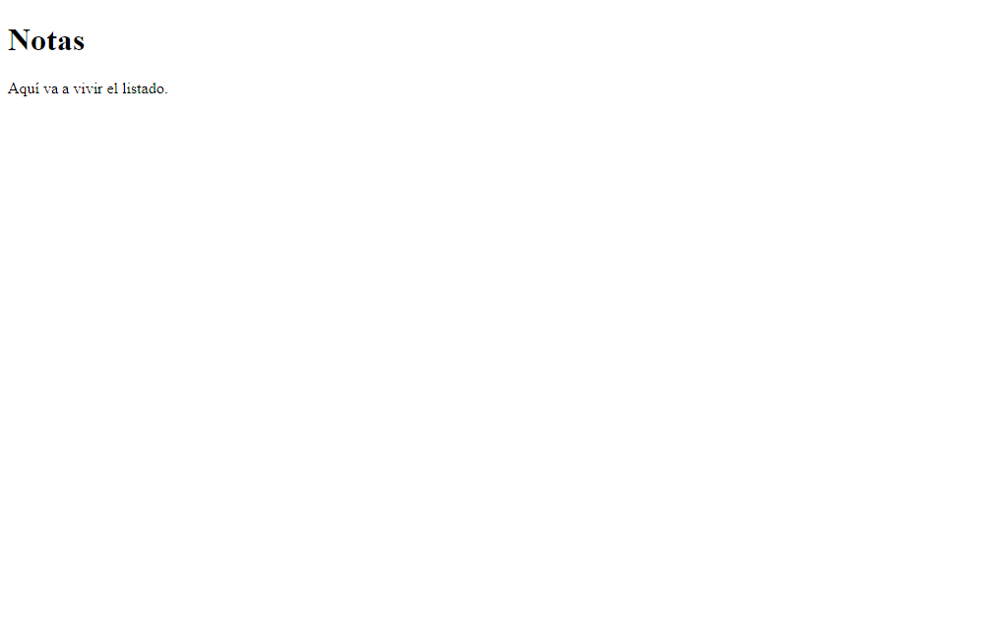

### 6.3 Ahora sí, las notas desde el modelo

La vista ya se renderiza, pero el controlador no consulta nada: el `<h1>` y el párrafo son fijos. Este
paso conecta las tres piezas que hasta aquí estaban sueltas —modelo, controlador y plantilla— y es el
primero que puede fallar por datos y no por cableado.

**Archivo**: `app/Http/Controllers/NotaController.php`.

**Acción**: suma el import del modelo, junto a los demás `use`, y pásale la colección a la vista:

```php
use App\Models\Nota;
```

**Archivo**: el mismo controlador, método `index()`.

```php
    public function index(Request $request, Response $response): Response
    {
        return $this->render($request, $response, 'notas/index.twig', [
            'notas' => Nota::orderByDesc('id')->get(),
        ]);
    }
```

**Archivo**: `resources/views/notas/index.twig`, el archivo estático de 6.2.

**Antes**: el párrafo que estaba debajo del título.

```twig
    <h1>Notas</h1>
    <p>Aquí va a vivir el listado.</p>
```

**Después**: reemplaza ese párrafo por la lista.

```twig
    <h1>Notas</h1>
    <ul>
        
            <li>{{ item.titulo }}</li>
        
            <li>No hay notas todavía.</li>
        
    </ul>
```

**Comprobación**: con la tabla vacía ves «No hay notas todavía.». Todavía no hay seed de `notas`: inserta
una fila a mano —un `INSERT` puntual contra `database/database.sqlite`, o el modelo que acabas de
crear— y aparece su título. El escapado de Twig convierte `<` y `&` en entidades: no uses `|raw` para
datos de usuario.

**Qué no prueba**: el shell ni los componentes visuales. Prueba el recorrido
controlador → modelo → plantilla.

**Falla si**:

- `Class "App\Http\Controllers\Nota" not found`: falta el `use App\Models\Nota;`.
- La lista sale vacía aunque haya filas: no estás pasando la clave `notas` o el nombre de la variable
  no coincide con el ``.
- Aparece HTML crudo del título: alguien agregó `|raw`; quitalo.

**Qué ganaste**: la pantalla muestra lo que hay en la tabla y, si está vacía, lo dice. Lo que se ve, sin
embargo, es el HTML suelto de 6.1: sin tema, sin menú y sin el usuario del paso 1, como una página de
otro sitio. El shell es el paso siguiente.

**Pieza — Eloquent**: `Nota::orderByDesc('id')->get()` devuelve una colección de modelos. El modelo
sabe a qué tabla mapear y qué columnas exponer; la vista solo recibe objetos y no consulta la base.


### 6.4 Ahora, el shell del proyecto

Una página suelta no se distingue de una app: le falta el sidebar, el header y el tema, y todo eso ya
existe en una plantilla del proyecto. Heredar de ella es también la forma de no repetir los assets ni el
marcado del shell en cada pantalla que agregues.

**Acción**: envuelve la misma vista en el layout. No cambies el contenido: el `<h1>`, la lista y el
texto del vacío quedan como están. Lo único que aparece son los bloques.

```twig


Notas


    <h1>Notas</h1>
    <ul>
        
            <li>{{ item.titulo }}</li>
        
            <li>No hay notas todavía.</li>
        
    </ul>

```

**Comprobación**: recarga `/notas`. Ahora está el sidebar —con tu usuario al pie, como en el paso 1—, el
header y el tema. **El `<body>`, el `<head>` y los assets ya no son tuyos.** El contenido se sigue viendo
como en 6.3: un título y una lista sin estilos propios, porque todavía no los tiene.

**Falla si**:

- Ves la página sin sidebar: falta el `` o la plantilla no es `layouts/app.twig`.
- Ves el contenido dos veces: quedó el `<!DOCTYPE html>` de 6.3 además de los bloques.
- El título de la pestaña no cambia por página: falta el ``.

**Qué no prueba**: que el contenido quede legible. Heredar el tema no estiliza tu marcado: eso es el paso
siguiente.

**Qué ganaste**: la pantalla es del proyecto —sidebar con tu usuario, header, tema, assets— y tuyo es sólo
el bloque `content`. Y mira el costo: título y lista quedaron en el mismo bloque, sin nada que puedas
reemplazar por separado.

**Pieza — `layouts/app.twig`**: resuelve el armado del shell completo (sidebar, header, avisos, tema,
assets con SRI) una sola vez. Úsalo en toda página tuya y escribe sólo el bloque `content`. Evita
rearmar el shell en cada pantalla y quedar desincronizado del resto. Sin él, cada vista repetiría el
header, y el tema se rompería en la que te olvidaras.

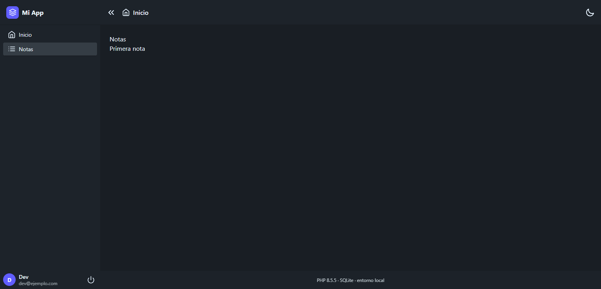

### 6.5 El diseño de la vista

La página ya vive en el shell, pero el contenido sigue siendo marcado pelado: un `h1` y una lista. El
proyecto tiene un idioma visual —tarjeta, espaciado, filas con borde— y aplicarlo es un paso aparte, para
que se vea qué aportó el shell y qué aporta el diseño.

**Acción**: envuelve el contenido en la tarjeta del proyecto y dale clases a la lista y a la fila.

```twig


Notas


    <section class="card border border-base-300 bg-base-100">
        <div class="card-body gap-4">
            <h1 class="text-2xl font-bold">Notas</h1>
            <ul class="space-y-2">
                
                    <li class="rounded-box border border-base-300 bg-base-100 p-3">
                        <span class="font-semibold">{{ item.titulo }}</span>
                    </li>
                
                    <li class="opacity-60">No hay notas todavía.</li>
                
            </ul>
        </div>
    </section>

```

**Qué hace cada clase**: `card` y `card-body` dan la tarjeta y su relleno; `space-y-2` separa las filas;
`rounded-box`, `border` y `p-3` hacen la fila; `font-semibold` pesa el título y `opacity-60` apaga el
vacío. Son clases de daisyUI y de Tailwind, que en este proyecto corre en el navegador.

**Comprobación**: la misma pantalla de 6.4, ahora con la tarjeta del proyecto y filas separadas y
legibles. Nada de lo que ves es CSS tuyo: todo viene de las clases.

**Falla si**:

- Todo se ve sin bordes ni espaciado: Tailwind no arrancó, o las clases faltan en el marcado.
- La tarjeta no aparece: falta `card`, o el contenido quedó fuera del `card-body`.

**Qué no prueba**: que la fila sea reutilizable. Todavía es marcado de esta pantalla; el capítulo 12 la
pasa a un componente.

**Qué ganaste**: la vista se ve como el resto de la app y el marcado dice qué es cada cosa. Lo que sigue
es separar el panel del resto de la página para poder refrescarlo solo.

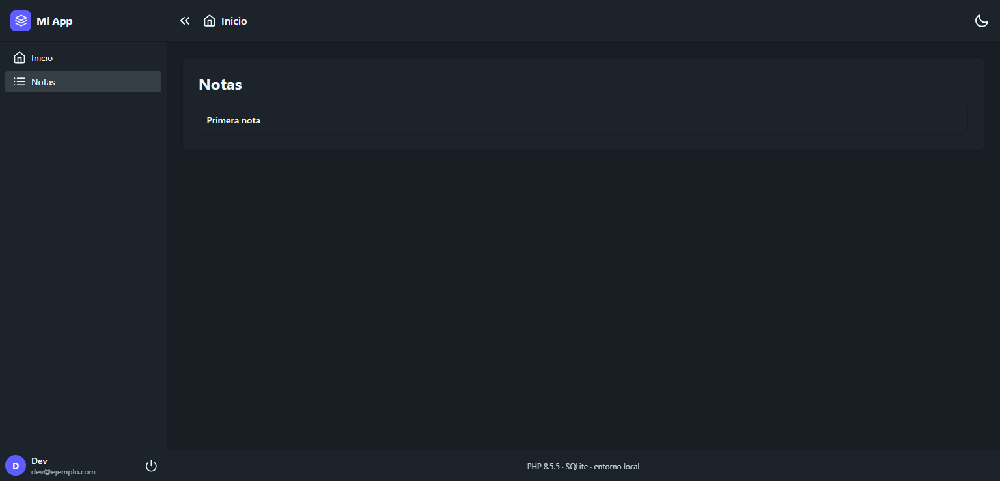

### 6.6 El panel a su propio archivo

El panel es la región que más adelante se va a refrescar sola. Sepáralo del resto de la página ahora,
todavía con el `<ul>` a mano: la lista funciona y no hace falta tocar Twig para tenerla ordenada.

**Acción**: mueve el `<ul>` completo de 6.4 a un parcial nuevo,
`resources/views/notas/_panel.twig`, sin cambiarle nada. El parcial se envuelve a sí mismo:

```twig
<div id="notas-panel">
    <ul class="space-y-2">
        
            <li class="rounded-box border border-base-300 bg-base-100 p-3">
                <span class="font-semibold">{{ item.titulo }}</span>
            </li>
        
            <li class="opacity-60">No hay notas todavía.</li>
        
    </ul>
</div>
```

**Archivo**: `resources/views/notas/index.twig`, bloque `content`.

**Antes**:

```twig
            <h1 class="text-2xl font-bold">Notas</h1>
            <ul class="space-y-2">
                {# … el bucle completo … #}
            </ul>
        </div>
```

**Después**: cambia el `<ul>` por el include, **sin** envolverlo.

```twig
            <h1 class="text-2xl font-bold">Notas</h1>
            
        </div>
```

**Comprobación**: la lista se ve **idéntica** a la de 6.4, con y sin notas.

**Por qué el `div` va adentro**: cuando más adelante el panel se intercambie con HTMX y `outerHTML`,
la respuesta **reemplaza** al elemento apuntado. Si el `div` viviera en `index.twig`, el primer swap
se lo llevaría junto con su id, y todo lo que apunte a `#notas-panel` quedaría apuntando a algo que ya
no existe.

**Falla si**:

- La lista desaparece: el include no está o apunta a otro nombre.
- Ves dos listas: quedó el `<ul>` original y además el include.

**Qué ganaste**: el panel es ahora una unidad que se puede reemplazar sin tocar el resto de la
página. Los pasos siguientes cambian su interior y `index.twig` no se entera.

> El `<ul>` y el `` se quedan a la vista hasta el capítulo 12. Recién ahí, con la entidad ya
> probada, la lista se extrae al componente del proyecto.


### 6.7 El encabezado con la acción y el contador

La pantalla ya lista, pero no ofrece nada: para crear una nota hay que conocer la URL del paso 5, y no
hay forma de saber cuántas hay. Necesita un encabezado que diga qué es, ofrezca la acción principal y
muestre el conteo. Escribámoslo a mano primero, para ver exactamente qué contiene.

**Archivo**: `resources/views/notas/index.twig`, bloque `content`.

**Antes**: después de 6.6, el `<h1>` sigue en `index.twig` y el panel se incluye debajo.

```twig
        <div class="card-body gap-4">
            <h1 class="text-2xl font-bold">Notas</h1>
            
        </div>
```

El botón va en la esquina: es la acción principal y el ojo la busca ahí. Por eso el título y el botón
comparten una fila —título a la izquierda, acción a la derecha— y debajo queda la fila del listado con
el contador.

**Después**: reemplaza ese `<h1>` por el encabezado con la acción y el contador; el include del panel
queda al final, dentro del mismo `card-body`.

```twig
        <div class="card-body gap-4">
            <div class="flex flex-wrap items-start justify-between gap-3">
                <div>
                    <h1 class="flex items-center gap-2 text-2xl font-bold">
                        <span class="opacity-60" aria-hidden="true">
                            
                        </span>
                        Notas
                    </h1>
                    <p class="mt-1 text-sm opacity-70">Tus notas, con alta y acciones por fila.</p>
                </div>
                <button class="btn btn-primary gap-2" data-modal-open="nota-create-modal">
                    Agregar nota
                </button>
            </div>

            <h2 class="text-lg font-semibold">Listado</h2>

            
        </div>
```

**Archivo**: `app/Http/Controllers/NotaController.php`, método `index()`.

**Antes**:

```php
    public function index(Request $request, Response $response): Response
    {
        return $this->render($request, $response, 'notas/index.twig', [
            'notas' => Nota::orderByDesc('id')->get(),
        ]);
    }
```

**Después**: el arreglo de datos suma dos cosas que **lee el shell, no tu vista**:

- `active`: el sidebar lo compara con la clave `key` de `config/navigation/notas.php` para marcar la
  entrada. Sin él, la página funciona igual pero el menú no resalta «Notas».
- `breadcrumbs`: el header arma la miga con `{label, href?, icon?, current?}`. Su fallback es un
  único «Inicio» marcado como actual, así que sin esta clave el encabezado dice que estás en la
  portada aunque estés en `/notas`. Con dos migas pinta la ruta y marca la última con
  `aria-current="page"`.

El repositorio tiene un test de contrato que recorre las páginas que pintan el shell y falla si alguna
no declara `breadcrumbs` (`tests/Support/ShellBreadcrumbContractTest.php`): el olvido no llega a
producción.

Agrega también `use Framework\Http\Url;`, que necesitas para el `href`.

```php
    public function index(Request $request, Response $response): Response
    {
        return $this->render($request, $response, 'notas/index.twig', [
            'notas'       => Nota::orderByDesc('id')->get(),
            'active'      => 'notas',
            'breadcrumbs' => [
                ['label' => 'Inicio', 'href' => Url::path('/')],
                ['label' => 'Notas', 'icon' => 'list', 'current' => true],
            ],
        ]);
    }
```

Ese `data-modal-open` no necesita un manejador en la vista: en este proyecto **ninguna vista escribe
JavaScript para abrir un diálogo**. El shell tiene un único listener delegado en `public/assets/app.js`
que busca el atributo, resuelve el id y llama `showModal()`. Alpine no participa: se ocupa del sidebar,
el tema y los avisos, y abrir un diálogo es una acción sobre un elemento del servidor, no un estado
reactivo. En 7.4 el botón pasa a `components/ui/button.twig`, que trae la misma delegación más
variante, icono y nombre accesible; el mecanismo no cambia.

**Comprobación**: aparecen el título, el botón «Agregar nota» a la derecha y la lista vacía. El botón
todavía no abre nada: el modal es el paso 7.

**Falla si**:

- El botón aparece sin estilo: la clase `btn` no existe en el bundle, o el layout no está cargando los assets.
- El header sigue diciendo «Inicio»: falta `breadcrumbs`, o la última miga no lleva `current` y el
  encabezado la pinta como enlace.

**Qué no prueba**: que el botón haga algo, ni que la fila tenga acciones. Eso son los pasos 7 y 8.

**Qué ganaste**: la pantalla ya dice qué es, ofrece la acción y cuenta las filas. Y mira el costo: el
encabezado quedó con nueve líneas de markup propio adentro de `index.twig`, más que el resto de la
vista, y ninguna habla de notas. Eso tiene arreglo, y es el paso siguiente.

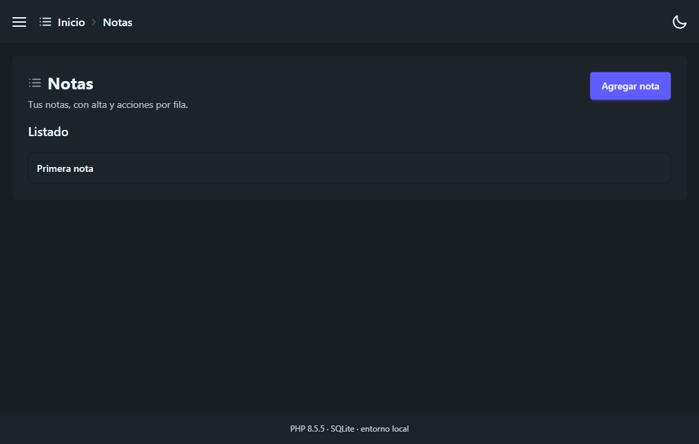

### 6.8 El encabezado a su componente

Fijate en lo que acabas de escribir. Esas líneas no tienen nada que ver con las notas: son la forma del
encabezado —el icono, el título, el subtítulo, la fila que alinea la acción—. Si mañana otra pantalla
necesita lo mismo, las copiarías; a la segunda copia una se vería distinta, y a la tercera ya no sabrías
cuál es la buena. Es el mismo caso del panel en 6.6, y el proyecto ya lo tiene resuelto:
`components/ui/page-header.twig`. Usémoslo: la vista deja de describir la forma y pasa a declarar el
contenido.

**Archivo**: `resources/views/notas/index.twig`, bloque `content`.

**Antes**: el armazón de 6.7, con el botón todavía crudo.

```twig
            <div class="flex flex-wrap items-start justify-between gap-3">
                <div>
                    <h1 class="flex items-center gap-2 text-2xl font-bold">
                        <span class="opacity-60" aria-hidden="true">
                            
                        </span>
                        Notas
                    </h1>
                    <p class="mt-1 text-sm opacity-70">Tus notas, con alta y acciones por fila.</p>
                </div>
                <button class="btn btn-primary gap-2" data-modal-open="nota-create-modal">
                    Agregar nota
                </button>
            </div>
```

**Después**: el mismo contenido en `components/ui/page-header.twig`. El `<div>`, el `<h1>` y el
subtítulo desaparecen de tu vista; queda el hueco.

```twig
            
                
                    <button class="btn btn-primary gap-2" data-modal-open="nota-create-modal">
                        Agregar nota
                    </button>
                
            
```

**Qué hace cada pieza**:

- `title` y `subtitle`: los mismos textos de antes. Se escapan solos. `subtitle` es opcional: si no lo
  pasas, no queda un `<p>` vacío.
- `icon`: opcional. Notas pasa `list` —el mismo icono del menú—; contactos usa `contacts`. El svg sale
  del registro compartido, y si el nombre no existe no se pinta nada.
- ``: el único hueco. Ahí va el control de la esquina, sea un botón, dos o un
  formulario entero. Es el mismo hueco que `body` en el modal y `row` en la lista. Se pinta **una sola
  vez** y no recibe variables: lo que uses, se lo pasas tú.

**Comprobación**: el encabezado se ve **idéntico** al de 6.7 —título con icono, subtítulo y botón a la
derecha— y el botón sigue sin abrir nada, porque el modal llega en el paso 7.

**Falla si**:

- El título sale vacío: `title` no está llegando o la prop se llama distinto.
- Queda una línea en blanco bajo el subtítulo: pasaste `subtitle: ''`; omítelo en vez de pasarlo vacío.
- El botón cae debajo del título: el `` quedó fuera del `embed`.
- El icono desaparece: el nombre no está en `partials/_icon.twig`.

**Qué no prueba**: que el demo de tareas use el mismo componente. Tasks tiene otra forma —el alta es un
formulario inline, no un botón en la esquina— y se queda como está a propósito; el formulario entraría
en `block actions` sin tocar el contrato.

**Qué ganaste**: el armazón del encabezado ya no vive en tu vista. Si mañana cambia el espaciado, el
tamaño del título o la posición del icono, cambia una vez y todas las pantallas que lo usan se enteran.

**Pieza — `components/ui/page-header.twig`**: resuelve la disposición del encabezado: el título a la
izquierda, el hueco de las acciones a la derecha. No repite el markup del título, lo incluye. Evita que
cada vista invente su variante —una con icono, otra sin, una con la acción a la derecha y otra sin
acción— y que el encabezado deje de ser reconocible entre pantallas. El botón cambia en 7.4 sin tocar el
encabezado.


### 6.9 La botonera a su componente

El encabezado ya es un componente, pero el control de la esquina sigue siendo un botón suelto dentro
del hueco. Con uno alcanza. Con dos —«Exportar» y «Agregar»— cada control se vuelve hijo directo del
`justify-between` del encabezado, que reparte el espacio entre todos: el primero queda flotando en el
medio de la pantalla, lejos de la esquina. La fila que falta también es un componente, y el proyecto
ya lo tiene. Usémoslo.

**Archivo**: `resources/views/notas/index.twig`, dentro del ``.

**Antes**: el botón suelto, como quedó en 6.7.

```twig
                
                    <button class="btn btn-primary gap-2" data-modal-open="nota-create-modal">
                        Agregar nota
                    </button>
                
```

Con un solo botón esto funciona. Con dos, no: cada control suelto se vuelve hijo directo del
`justify-between` del encabezado, que reparte el espacio entre todos —el título a la izquierda, el
primero en el medio y el último a la derecha—. La botonera es la fila que falta.

**Después**: el botón adentro de `components/ui/action-bar.twig`, que es dueña del `flex`, el `wrap` y
la separación.

```twig
                
                    
                        
                            <button class="btn btn-primary gap-2" data-modal-open="nota-create-modal">
                                Agregar nota
                            </button>
                        
                    
                
```

**Qué hace cada pieza**:

- El bloque se llama `controls`, no `actions`: queda adentro del bloque `actions` del encabezado, y dos
  bloques con el mismo nombre se leen mal.
- El componente **no** ordena: la fila es suya, el orden es tuyo. El criterio del proyecto es secundario
  primero y primario al final, pegado al borde: es donde el ojo lo busca y donde el pulgar lo alcanza en
  el móvil.
- `extra_class` es opcional, para alinear o separar distinto en un caso concreto.

**Comprobación**: el encabezado se ve **idéntico** al de 6.8 y el botón sigue sin abrir nada.

**Falla si**:

- Dos controles se reparten por la pantalla, uno en el medio: faltó la botonera.
- El control se estira a todo el ancho de la esquina: la fila quedó fuera del `embed`.

**Cuando aparezca el segundo control**, los dos van adentro de la botonera y en este orden:

```twig

    
        
        
    

```

Cuidado con el primero: en un listado, «Volver» duplica el sidebar y el botón del navegador, y gana su
lugar recién en una pantalla de detalle. Los segundos controles que sí lo justifican son «Exportar»,
«Filtros» o «Actualizar».

**Qué ganaste**: la botonera es dueña del `flex`, el `wrap` y la separación; tu vista pone los controles
y su orden. El día que aparezca el segundo botón no hay espacios que ajustar ni clases que recordar.

**Pieza — `components/ui/action-bar.twig`**: resuelve la fila de controles del encabezado o de una
tarjeta, con su separación y su wrap. Úsala siempre que la esquina lleve más de un control; sin ella,
cada pantalla elige su `gap` y su alineación.


### 6.10 Anatomía del encabezado

Usaste el encabezado completo sin ver cómo está armado, y vale la pena mirarlo: la forma en que se
compone es la que vas a repetir cuando hagas tus propios compuestos. La idea es simple —un wrapper que
pone la disposición y dos piezas que aportan el contenido— y se ve mejor en el código que en la
explicación.

`resources/views/components/ui/page-header-title.twig` es la mitad izquierda:

```twig
<div>
    <h1 class="flex items-center gap-2 text-2xl font-bold">
        {# el icono, si lo hay:  #}
        {{ title }}
    </h1>
    
        <p class="mt-1 text-sm opacity-70">{{ subtitle }}</p>
    
</div>
```

Y `resources/views/components/ui/page-header.twig` es el wrapper: no repite ese markup, lo incluye, y
deja el hueco para la botonera.

```twig
<div class="flex flex-wrap items-start justify-between gap-3">
    
    
</div>
```

**Por qué la botonera se anida del lado de la vista**: en Twig, un bloque se rellena en el sitio de
llamada, no donde se declara. `actions` se define en tu `index.twig`, así que `page-header` no puede
envolverlo con `action-bar`. Si lo hiciera, tendría que repetir la lista de clases de la botonera y
quedarían dos formas de hacer lo mismo.

**Qué te deja**: tres contratos en vez de un bloque de markup. El título se puede usar solo —el
encabezado de una tarjeta, un estado vacío— y la botonera también, sobre una tabla o un listado. Cuando
hagas tu propio compuesto, la regla es la misma: el wrapper pone la disposición, los hijos aportan el
contenido.


---

## 7. El alta: del formulario crudo al modal del proyecto

**Objetivo**: crear notas desde un diálogo, entendiendo qué aporta cada componente en el camino.

**Estado de partida**: paso 6 hecho; el botón «Agregar nota» existe y no abre nada.

### 7.1 Un diálogo nativo con campos a mano

La pantalla lista y cuenta las filas, pero no hay forma de crear una: el botón «Agregar nota» no abre
nada, porque no existe la acción que reciba el formulario. Este paso agrega el alta completa —diálogo,
campos y `store()`— en su versión mínima, para que funcione antes de embellecerla.

El diálogo se declara al final del bloque, cerrado, y lo abre el botón del encabezado por su `id`: así el
formulario no ocupa lugar en la página hasta que alguien lo pide. Es la forma más barata de tener alta sin
salir del listado, y por eso el proyecto la conserva.

**Archivo**: `resources/views/notas/index.twig`, bloque `content`, después de `</section>` y antes de
``.

**Acción**: agrega un `<dialog>` nativo con el formulario a mano.

> El modal va **adentro** de ``. Si lo pones después de ``, Twig lo
> ignora sin error: el archivo se ve bien y el botón no abre nada. Es el error más silencioso de este
> paso.

```twig
<dialog id="nota-create-modal" class="modal">
    <div class="modal-box">
        <h3 class="text-lg font-bold">Nueva nota</h3>
        <form method="post" action="{{ url('/notas') }}" class="space-y-4">
            <input type="hidden" name="csrf_name" value="{{ csrf_name }}">
            <input type="hidden" name="csrf_value" value="{{ csrf_value }}">

            <label class="label" for="titulo">Título</label>
            <input id="titulo" name="titulo" class="input w-full" required maxlength="120">

            <label class="label" for="cuerpo">Cuerpo</label>
            <input id="cuerpo" name="cuerpo" class="input w-full" maxlength="2000">

            <div class="modal-action">
                <button type="button" class="btn btn-ghost" data-modal-close>Cancelar</button>
                <button type="submit" class="btn btn-primary">Crear nota</button>
            </div>
        </form>
    </div>
</dialog>
```

**Archivo**: `app/Http/Controllers/NotaController.php`, método `store()`.

Vas a necesitar dos `use` más arriba del archivo, junto a los que ya están (`Url` ya lo tienes de 6.7):

```php
use Framework\Http\Flash;
use Framework\Validation\Validator;
```

```php
    public function store(Request $request, Response $response): Response
    {
        $data = (array) $request->getParsedBody();
        $data['cuerpo'] = trim((string) ($data['cuerpo'] ?? ''));

        $validator = Validator::make($data, [
            'titulo' => 'required|max:120',
            'cuerpo' => 'max:2000',
        ]);

        if ($validator->fails()) {
            return $this->render($request, $response, 'notas/index.twig', [
                'notas'  => Nota::orderByDesc('id')->get(),
                'active' => 'notas',
            ])->withStatus(422);
        }

        Nota::create([
            'titulo' => (string) $data['titulo'],
            'cuerpo' => $data['cuerpo'] !== '' ? $data['cuerpo'] : null,
        ]);

        Flash::set('success', 'Nota creada.');

        return $response->withStatus(303)->withHeader('Location', Url::path('/notas'));
    }
```

**Archivo**: `routes/notas.php`, dentro del `group('/notas')`.

**Antes**:

```php
        $group->get('', [NotaController::class, 'index']);
```

**Después**: agrega el `post` debajo del `get`; las dos rutas comparten el grupo y el middleware de
sesión.

```php
        $group->get('', [NotaController::class, 'index']);
        $group->post('', [NotaController::class, 'store']);
```

Se registra aquí, con su acción, y no en el paso 4: una ruta sin acción es una promesa que el framework
no puede cumplir —y el error aparece recién cuando alguien la visita—.

**Archivo**: el mismo controlador, dentro de la clase.

Y para que el aviso llegue en una pantalla con redirect, el controlador opta por el toast del shell:

```php
    protected function usesToastFlash(): bool
    {
        return true;
    }
```

**Comprobación**: toca «Agregar nota»: se abre el diálogo nativo. Guarda con un título: vuelves a
`/notas`, la nota aparece y el aviso «Nota creada.» sale abajo a la derecha.

**Qué no prueba**: que el error quede donde corresponde. Si el POST falla la validación, este
formulario repinta la página y **pierde lo tipeado y el modal abierto**.

**Qué ganaste**: el alta funciona de punta a punta: el diálogo abre, el servidor valida, la nota aparece
en la lista y el aviso sale abajo a la derecha. Y mira el costo: dos `label` y dos `input` escritos a
mano, sin marca de opcional, sin un lugar donde el error caiga al lado del campo y con el par de CSRF
repetido en cada formulario.

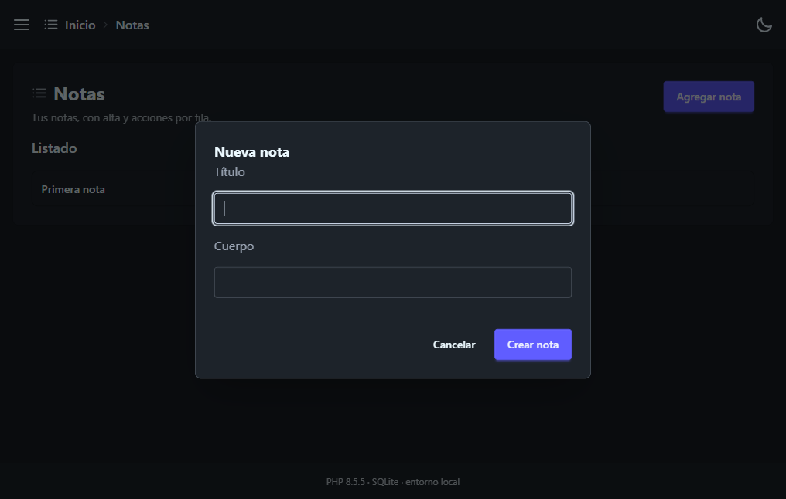

### 7.2 Sustituir los campos a mano por el del proyecto

El formulario se envía, pero no se puede rechazar bien: no hay dónde poner el error y, cuando lo haya, no
estará pegado al campo que lo causó. El componente del proyecto resuelve el campo entero —label, marca de
opcional, mensaje y atributos de accesibilidad—, y ese contrato es el que 7.5 necesita para mostrar un
rechazo.

**Archivo**: `resources/views/notas/index.twig`, dentro del `<form>` del diálogo de 7.1.

**Antes**: los dos pares `label` + `input` y los dos `hidden` de CSRF.

```twig
            <label class="label" for="titulo">Título</label>
            <input id="titulo" name="titulo" class="input w-full" maxlength="120">

            <label class="label" for="cuerpo">Cuerpo</label>
            <input id="cuerpo" name="cuerpo" class="input w-full" maxlength="2000">

            <input type="hidden" name="csrf_name" value="{{ csrf_name }}">
            <input type="hidden" name="csrf_value" value="{{ csrf_value }}">
```

**Después**: cambia cada par `label` + `input` por el componente, que trae label, error asociado y
atributos de accesibilidad.

```twig





```

`values` es lo que el usuario tipeó cuando el render viene de un rechazo; si no vino, cae a vacío. Con
`|default('')` sobre cada campo, un título vacío tipeado a propósito volvería al valor guardado, y
el usuario vería el dato viejo en el campo que acaba de borrar.

**Archivo**: el mismo `index.twig`, dentro del `<form>`, donde estaban los dos `hidden`.

**Antes**:

```twig
            <input type="hidden" name="csrf_name" value="{{ csrf_name }}">
            <input type="hidden" name="csrf_value" value="{{ csrf_value }}">
```

**Después**: reemplazalos por el partial que emite los dos campos.

```twig
            
```

**Comprobación**: los campos quedan en el mismo lugar y el input mide lo mismo, pero el label pasa a
`label.fieldset-legend` (12px semibold en vez de 16px normal) y el HTML ahora es un `fieldset` con su
label asociado por `for`/`id`. El campo opcional dice «(opcional)» y se mantienen `required` y
`maxlength`. Mira el HTML con el inspector: `label for` coincide con el `id` del input.

> Los atributos `aria-invalid` y `aria-describedby` que agrega el componente **recién se ven cuando hay
> error**, y eso llega en el paso 7.5, cuando el controlador empieza a devolver `errors`. En este paso
> el formulario todavía no tiene cómo producirlos.

**Qué ganaste**: el campo como una unidad con su label, su marca de opcional y el lugar donde irá el
mensaje. Eso antes no existía: tenías un `label` y un `input` sueltos que se podían desincronizar.

**Pieza — `components/form/field.twig`**: resuelve el campo con su label, su mensaje y sus atributos
de accesibilidad. Úsalo en vez de `<input>` sueltos. Evita el error que no queda pegado al campo que lo
causó. Con `error`, el input sale con `aria-invalid` y `aria-describedby` apuntando al mensaje.

**Pieza — `partials/_csrf.twig`**: resuelve los dos campos ocultos del token. Va **dentro** de todo
`<form>` que mute datos. Evita el rechazo con redirect al login que no explica nada.

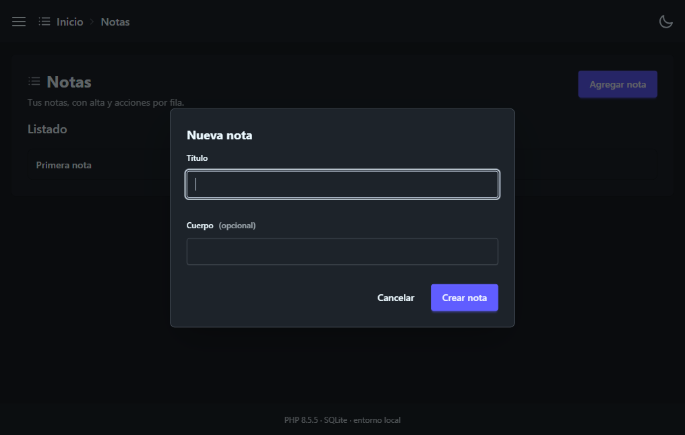

### 7.3 Extraer el formulario a un parcial

El formulario ya está bien armado, pero vive adentro del `<dialog>` y del bloque `content`: no hay manera
de usarlo en un segundo lugar sin copiarlo. El capítulo 9 necesita el mismo formulario para editar, con
otro `action` y otros textos; separarlo ahora cuesta menos que unificar dos copias después.

**Acción**: mueve el formulario que hoy vive dentro del `<dialog>` a
`resources/views/notas/_form.twig`:

```twig
{# `form_values` gana sobre la nota guardada: en un rechazo se repinta lo que el
   usuario tipeó, no lo que hay en la base. #}


<form method="post" action="{{ action }}" class="space-y-4"
      onsubmit="this.querySelector('[type=submit]').disabled = true">
    

    

    

    <div class="modal-action">
        
        
    </div>
</form>
```

El parcial no sabe si el formulario es de alta o de edición: recibe `action`, `submit_label`,
`submit_icon` y, cuando corresponde, `nota`. `values` resuelve el orden: primero lo que el usuario
tipeó en un rechazo (`form_values`), después la nota guardada, y al final vacío.

El `onsubmit` deshabilita el botón de envío para evitar un doble POST por doble clic. El botón
«Cancelar» usa `data_modal_close`, que el shell traduce a `close()` sobre el `<dialog>` que lo contiene;
por eso funciona igual en el diálogo nativo de este paso y en el modal del proyecto del paso siguiente.
Los dos botones usan `components/ui/button.twig`, el mismo que vas a ver en 8.2: encapsula variante,
icono y cierre.

**Archivo**: `resources/views/notas/index.twig`, dentro de `<dialog id="nota-create-modal">` y de
`<div class="modal-box">`.

**Antes**: el `<form> … </form>` inline de 7.1.

**Después**: reemplaza ese formulario por el include; el `<h3>` y el `<div class="modal-box">` se
conservan.

```twig
            <h3 class="text-lg font-bold">Nueva nota</h3>
            
        </div>
    </dialog>
```

Sin `only` en ese `include`. `_form.twig` incluye `partials/_csrf.twig`, que necesita las cuatro
variables del token; `render()` las inyecta en el contexto de `index.twig`, y `only` corta justo ese
contexto. Con `only` los dos campos ocultos salen con `name=""` y el POST termina en un 303 al login
sin ningún mensaje.

`nota: null` parece un detalle, pero corta la herencia: cuando este mismo parcial se use en el modal de
edición, no queremos que el alta se abra con los datos de la nota que se está editando.

**Comprobación**: el botón «Agregar nota» sigue abriendo el diálogo; «Cancelar» lo cierra y crear una
nota sigue funcionando. Lo único que cambió es que el formulario ahora vive en un archivo reutilizable.

**Qué no prueba**: el modal del proyecto ni la reapertura con errores. El rechazo del servidor todavía
no vuelve a abrir nada; eso llega en 7.5.

**Falla si**:

- El diálogo aparece vacío: el `include` no está o el parcial no recibe `action`.
- El botón «Cancelar» no cierra: el `data_modal_close` quedó fuera del `<dialog>` o el parcial no se
  está renderizando adentro.
- El formulario se envía a la URL equivocada: `action` no se está pasando o quedó el `action` viejo.

**Qué ganaste**: el formulario es un archivo con contrato —`action`, etiqueta del botón, valores— y el
diálogo sólo lo incluye. Lo que todavía no es del proyecto es el diálogo y el botón que lo abre: uno es
un `<dialog>` armado a mano y el otro llama a `showModal()` por su cuenta. Eso es 7.4.

**Pieza — un formulario, dos operaciones**: resuelve el formulario una sola vez y evita que el alta y
la edición tengan campos o validaciones distintas. Úsalo cuando los campos son los mismos. Sin esto,
cada operación repite el formulario y una de las dos se olvida de un campo.

La pantalla es la de 7.2: el formulario se movió a un parcial y se ve igual.

### 7.4 Reemplazar el `<dialog>` crudo por el modal del proyecto

El diálogo nativo funciona, pero el proyecto ya tiene un modal con tema, telón, foco y cierre por
Escape. Y el botón del encabezado todavía es un `<button>` suelto: cada pantalla que necesite abrir ese
modal tendría que repetir sus clases.

**Archivo**: `resources/views/notas/index.twig`, bloque `content`, después de `</section>` y antes de
``.

**Acción**: reemplaza todo el `<dialog> … </dialog>` por el componente:

```twig
    
        
            
        
    
```

**Archivo**: el mismo `index.twig`, dentro del `` del encabezado.

**Antes**:

```twig
                <button class="btn btn-primary gap-2" data-modal-open="nota-create-modal">
                    Agregar nota
                </button>
```

**Después**: reemplaza el botón crudo por el botón del proyecto.

```twig
                
```

El componente usa la misma delegación que el botón crudo de 6.7 —`data_modal_open` la resuelve el
shell— y suma lo que al `<button>` suelto le falta: variante, icono y `aria_label` cuando el texto no
alcanza. El foco, el estilo y Escape siguen iguales para todos los botones.

**Comprobación**: el botón sigue abriendo el modal, ahora con el telón y el tema del proyecto. Escape,
el botón de cerrar y «Cancelar» lo cierran; crear una nota sigue igual.

**Qué no prueba**: que un rechazo del servidor lo vuelva a abrir. En este paso el modal siempre nace
cerrado (`open: false`).

**Falla si**:

- El botón no abre nada: `data_modal_open` no coincide con el `id` del modal.
- Ves el formulario fuera del modal: el `embed` no está dentro de ``.
- El modal abre con datos de otra nota: falta `nota: null` en el include del alta.

**Qué ganaste**: el modal es del proyecto —telón, foco, cierre con Escape y botón de cerrar— y tu vista
sólo declara el título, el subtítulo y el cuerpo. El costo se ve al rechazar: el modal nace siempre
cerrado, así que un 422 deja el error en una página sin contexto.

**Pieza — `components/ui/modal.twig`**: resuelve el `<dialog>`, el telón, el foco y el cierre. Úsalo
para todo modal del proyecto. Evita rearmar el mismo diálogo a mano en cada vista. Sin él,
cada pantalla inventa su forma de abrir y cerrar, y el foco se comporta distinto en cada una.

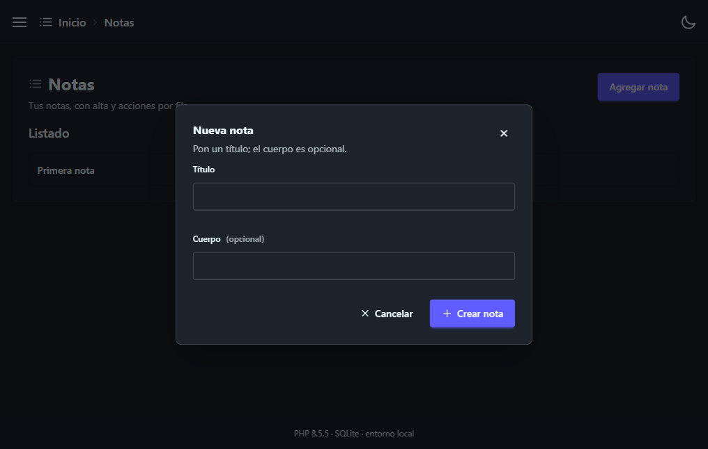

### 7.5 Reabrir el modal con errores 422

Un formulario inválido no es una página nueva: es la misma página con el modal abierto, los errores y
lo que el usuario ya había tipeado. Si el servidor devuelve la página con el modal cerrado, el usuario
ve el error pero pierde el contexto.

**Archivo**: `app/Http/Controllers/NotaController.php`, método `store()`, dentro de
`if ($validator->fails())`.

**Antes**: el rechazo sólo devuelve la lista y el estado 422.

```php
        if ($validator->fails()) {
            return $this->render($request, $response, 'notas/index.twig', [
                'notas'  => Nota::orderByDesc('id')->get(),
                'active' => 'notas',
            ])->withStatus(422);
        }
```

**Después**: agrega `errors`, `form_values` y `open_create_modal` al mismo render.

```php
        if ($validator->fails()) {
            return $this->render($request, $response, 'notas/index.twig', [
                'notas'             => Nota::orderByDesc('id')->get(),
                'errors'            => $validator->errors(),
                'form_values'       => $data,
                'open_create_modal' => true,
                'active'            => 'notas',
            ])->withStatus(422);
        }
```

**Archivo**: `resources/views/notas/index.twig`, dentro del ``
del modal de alta.

**Antes**:

```twig
        open: false
```

**Después**: reemplaza esa línea por:

```twig
        open: open_create_modal|default(false)
```

Así el alta normal nace cerrada y el rechazo la abre. `form_values` hace que `_form.twig` repinte lo
tipeado; `errors` hace que cada campo muestre su mensaje.

**Comprobación**: el servidor ya sabe rechazar, pero la pantalla no lo deja llegar: el campo lleva
`required`, así que el navegador bloquea el envío con su propio globo y el POST nunca sale. Para ver el
422 hay que mandar el formulario sin pasar por esa validación, y para eso hace falta una sesión. El
bloque completo, de la nada al 422: los tres pasos van en el mismo shell porque comparten el archivo
de cookies.

```bash
J=/tmp/notas-cookies.txt
rm -f $J

# 1. iniciar sesión. El jar arranca vacío: sin este paso, todo lo que sigue responde 303 a /login.
curl -s -c $J http://127.0.0.1:8080/login > /tmp/login.html
csrf_name=$(grep -o 'name="csrf_name" value="[^"]*"' /tmp/login.html | head -1 | sed 's/.*value="//;s/"//')
csrf_value=$(grep -o 'name="csrf_value" value="[^"]*"' /tmp/login.html | head -1 | sed 's/.*value="//;s/"//')
curl -s -o /dev/null -w 'login=%{http_code}' -b $J -c $J --data-urlencode "csrf_name=$csrf_name" --data-urlencode "csrf_value=$csrf_value" --data-urlencode "email=dev@ejemplo.com" --data-urlencode "password=una-clave-de-8-o-mas" http://127.0.0.1:8080/login; echo
# login=303. Un 200 acá significa que la sesión no se creó y el POST de abajo va a dar 303 otra vez.

# 2. con la sesión, el par CSRF del alta sale del propio listado
curl -s -c $J -b $J http://127.0.0.1:8080/notas > /tmp/notas.html
csrf_name=$(grep -o 'name="csrf_name" value="[^"]*"' /tmp/notas.html | head -1 | sed 's/.*value="//;s/"//')
csrf_value=$(grep -o 'name="csrf_value" value="[^"]*"' /tmp/notas.html | head -1 | sed 's/.*value="//;s/"//')

# 3. POST con el título vacío: tiene que responder 422 y traer el modal abierto
curl -s -o /tmp/resp.html -w 'post=%{http_code}' -b $J --data-urlencode "csrf_name=$csrf_name" --data-urlencode "csrf_value=$csrf_value" --data-urlencode "titulo=" --data-urlencode "cuerpo=cuerpo que debe sobrevivir" http://127.0.0.1:8080/notas; echo
grep -c 'nota-create-modal[^>]*open' /tmp/resp.html   # 1
grep -c 'Este campo es obligatorio.' /tmp/resp.html    # 1
grep -c 'cuerpo que debe sobrevivir' /tmp/resp.html    # 1
```

Los tres `grep -c` tienen que dar `1`: modal abierto, error junto al campo y lo tipeado conservado.
Desde el capítulo 11 el mismo caso queda como test y se corre con `vendor/bin/phpunit --filter NotaTest`.

El `required` se queda: es defensa en profundidad. El navegador ahorra el viaje; el servidor no confía
en él, y por eso la validación también vive en `store()`.

**Falla si**:

- El modal queda cerrado: falta `open_create_modal` o el modal no lo está leyendo.
- Los errores no aparecen: no estás pasando `errors` a `_form.twig`.
- Se borra lo tipeado: falta `form_values`.
- El error sale en el modal de edición: `nota` está llegando con datos en el alta; revisa el `nota: null`.

**Qué no prueba**: que dos pestañas abiertas no se pisen; no hay control de concurrencia.

**Qué ganaste**: un formulario rechazado vuelve con el modal abierto, el error junto al campo y lo que
habías escrito; el `required` del navegador queda como primera barrera en vez de única. Y mira el costo:
cada render de rechazo repite a mano la lista, el estado y las claves del modal. En 13.3 eso se
junta en un solo método.

**Pieza — `errors` + `form_values` + `open_*`**: el servidor es dueño del estado del modal. Úsalo en
todo formulario que pueda rechazarse. Evita que el usuario pierda lo escrito y que el error aparezca en
una pantalla sin contexto. Sin esto, el 422 se ve como una recarga cualquiera.

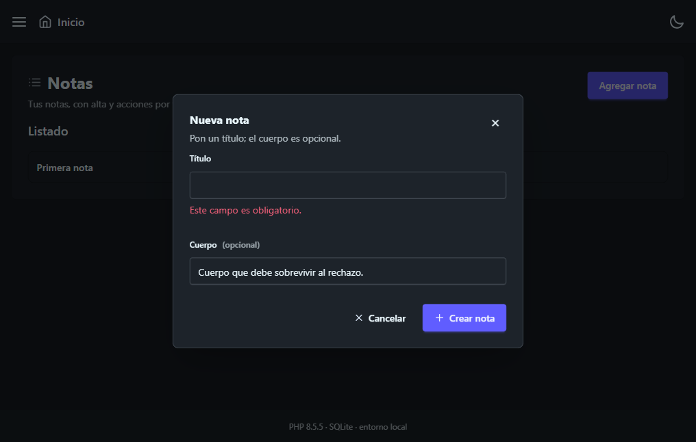

---

## 8. Las acciones por fila: del icono mudo al botón accesible

**Objetivo**: que cada fila ofrezca editar y borrar, con nombre accesible.

**Estado de partida**: paso 7 hecho; hay al menos una nota en la lista.

### 8.1 Primero, el atajo que no se debe dejar

La fila muestra el título y nada más: no hay forma de llegar a una nota ni de quitarla desde la pantalla.
El atajo más rápido es un emoji en un enlace y otro en un botón, y este paso lo escribe a propósito, para
ver el resultado y su falla antes de arreglarla.

**Archivo**: `resources/views/notas/_panel.twig`, dentro del `<li>` del ``.

**Acción**: la fila pasa a ser flex —si no, las acciones caen debajo del título en vez de quedar a la
derecha— y se agregan los dos controles con emoji. El `<li>` queda así:

```twig
<li class="flex items-start justify-between gap-3 rounded-box border border-base-300 bg-base-100 p-3">
    <span class="font-semibold">{{ item.titulo }}</span>
    <div class="flex shrink-0 items-center gap-1">
        <a class="btn btn-ghost btn-sm" href="{{ url('/notas/' ~ item.id ~ '/edit') }}">✏️</a>
        <button class="btn btn-ghost btn-sm" data-modal-open="nota-delete-{{ item.id }}">🗑️</button>
    </div>
</li>
```

**Comprobación**: se ven dos iconos por fila. Y si abres el inspector o pasas el lector de pantalla,
los dos controles **no tienen nombre**: el enlace se anuncia como «✏️» y el botón como «🗑️». Para
alguien que no ve la pantalla, son dos botones indistinguibles.

**Qué ganaste**: un defecto visible. Los dos controles funcionan, pero ninguno se puede anunciar; ahora
sabes señalarlo, y el paso siguiente arregla algo que ya no es una opinión.

**Qué no prueba**: nada del comportamiento. Borra y edita con un emoji igual de bien; lo que falta es
que alguien que no ve la pantalla pueda usar la fila.

> El `data-modal-open` apunta a un diálogo que todavía no existe —llega en el capítulo 10—, y eso es a
> propósito: así el botón parece conectado y el único defecto que queda a la vista es que **no tiene
> nombre**. Si el atajo fallara además por otro lado, el paso dejaría de hablar de accesibilidad.


### 8.2 Ahora, el botón del proyecto

El atajo deja dos controles que existen y no se pueden usar: uno se anuncia como «✏️», el otro como
«🗑️», y el botón de borrar ni siquiera abre algo. Este paso los sustituye por el botón del proyecto, que
trae el icono del registro compartido y el nombre que anuncia el lector de pantalla, y registra las tres
rutas que faltan, para que el lápiz ya no apunte a una URL que no existe.

**Archivo**: `resources/views/notas/_panel.twig`, dentro del `<li>` del ``.

**Acción**: reemplaza los dos por el componente, con icono del registro compartido y nombre accesible:

```twig
                <div class="flex shrink-0 items-center gap-1">
                    

                    
                </div>
```

El componente no recibe manejadores: `data_modal_open` le pide al shell que abra
ese `<dialog>` con `showModal()`. Así el botón conserva foco, Escape y el
tratamiento visual del proyecto.

**Archivo**: `routes/notas.php`, dentro del `group('/notas')`.

**Antes**: el archivo sólo tiene el listado y el alta.

```php
        $group->get('', [NotaController::class, 'index']);
        $group->post('', [NotaController::class, 'store']);
```

**Después**: agrega las tres rutas de edición y borrado; el archivo queda con cinco.

```php
        $group->get('', [NotaController::class, 'index']);
        $group->post('', [NotaController::class, 'store']);
        $group->get('/{id}/edit', [NotaController::class, 'edit']);
        $group->post('/{id}', [NotaController::class, 'update']);
        $group->post('/{id}/delete', [NotaController::class, 'destroy']);
```

`edit()` y `update()` se implementan en el paso 9; `destroy()` en el paso 10. Hasta entonces, tocar el
lápiz da error, y eso es lo esperado en este punto: la ruta existe y la acción no, así que el error
sale del contenedor y no del framework como un 404.

**Comprobación**: los iconos se ven igual, pero cada control ahora se anuncia como «Editar <título>» y
«Borrar <título>». El lápiz navega a `/notas/{id}/edit`; la papelera todavía no abre nada, porque el
diálogo llega en el paso 10.

**Qué ganaste**: nombre accesible, icono del registro compartido y el mismo tratamiento visual que el
resto de la app.

**Falla si**:

- Los botones aparecen como cuadrados vacíos: falta el `icon`, o el nombre no existe en el registro.
- El lápiz no navega: `href` no llega (con `href` el componente emite `<a>`).

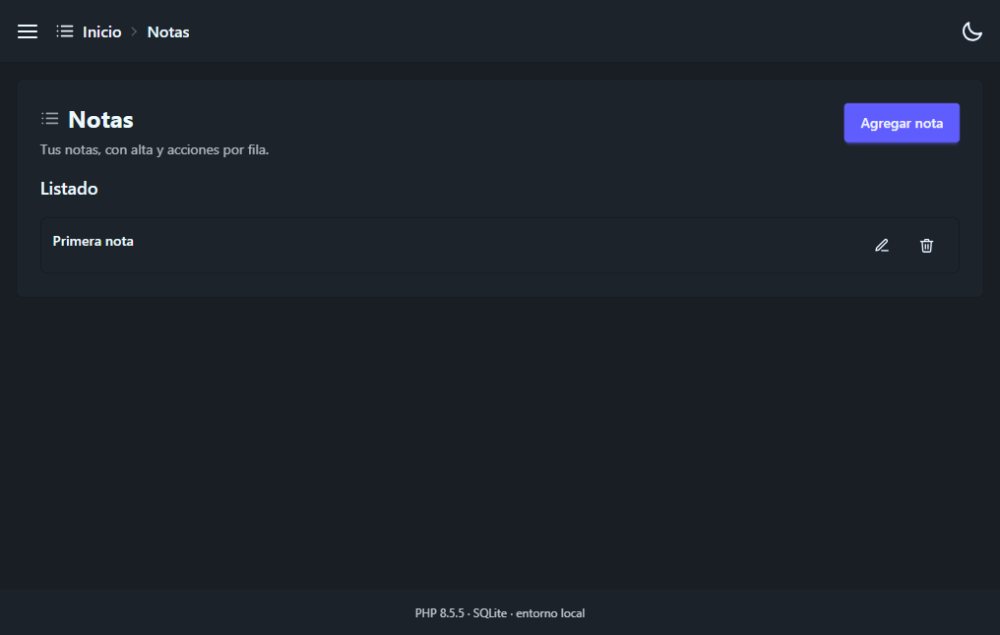

---

## 9. Editar en el mismo modal

**Objetivo**: editar una nota reusando el formulario y el diálogo del alta.

**Estado de partida**: paso 8 hecho; el lápiz navega a `/notas/{id}/edit`, una ruta que existe pero
cuya acción todavía no.

### 9.1 Abrir el modal con la nota

El lápiz ya navega, pero del otro lado no hay nada: `/notas/{id}/edit` no tiene acción y un id inexistente
tampoco tiene respuesta. Este paso crea `edit()` y el segundo modal, y deja el guardado para 9.2 para
comprobar primero que los datos llegan enteros.

La edición no agrega campos: el formulario ya está escrito y lo que falta es un segundo modal que lo
envuelva con otro `action`. Por eso `index.twig` crece con un `embed` más, envuelto en un `if` que lo deja
existir sólo cuando hay `nota`.

**Archivo**: `app/Http/Controllers/NotaController.php`.

**Acción**: suma el import de la excepción y crea `edit()`:

```php
use Slim\Exception\HttpNotFoundException;
```

```php
    public function edit(Request $request, Response $response, array $args): Response
    {
        $nota = Nota::find((int) $args['id']);

        if ($nota === null) {
            throw new HttpNotFoundException($request, 'No existe una nota con ese identificador.');
        }

        return $this->render($request, $response, 'notas/index.twig', [
            'notas'           => Nota::orderByDesc('id')->get(),
            'nota'            => $nota,
            'open_edit_modal' => true,
            'active'          => 'notas',
        ]);
    }
```

`edit()` no renderiza una pantalla nueva: reusa `index.twig`, le pasa la nota y le dice que abra el
modal de edición. Así el formulario, el modal y la lista ya están en la misma página.

**Archivo**: `resources/views/notas/index.twig`, bloque `content`, después del `` del
modal de alta.

Ahora agrega el segundo modal. Sólo se renderiza cuando hay `nota`:

```twig
    
        
            
                
            
        
    
```

El `action` apunta a `/notas/{id}`; la ruta ya está registrada desde el paso 8, pero la acción `update()`
todavía no existe. Por eso en este paso el botón «Guardar cambios» **no guarda**. Primero comprobamos que
el modal abre con los datos correctos.

**Comprobación**: toca el lápiz de una nota. Esperado: se abre un modal con el título y el cuerpo ya
cargados. Un id que no existe (`/notas/99999/edit`) tiene que dar la página 404 del framework, no un
error de PHP.

**Qué no prueba**: guardar cambios. Eso es 9.2.

**Falla si**:

- El modal abre vacío: `nota` no está llegando, o `_form.twig` no está leyendo `nota`.
- El lápiz abre la página pero no el modal: falta `open_edit_modal` o el `id` no coincide.
- El 404 sale como 500: no estás lanzando `HttpNotFoundException` antes de tocar la nota.
- Ves el modal de edición en el alta: `nota` se está pasando sin querer; el alta debe llevar `nota: null`.

**Qué ganaste**: el modal abre con el título y el cuerpo guardados, y un id que no existe da la 404 del
framework en vez de un error de PHP. Falta lo obvio al primer clic: «Guardar cambios» no guarda, porque
`update()` todavía no existe. Eso es 9.2.

**Pieza — reusar `index.twig` para editar**: resuelve una sola página con dos modales y evita duplicar
la lista. Úsalo cuando la edición comparte la pantalla con el listado. Sin esto, el alta y la edición
tienen dos copias de la tabla y se desincronizan.

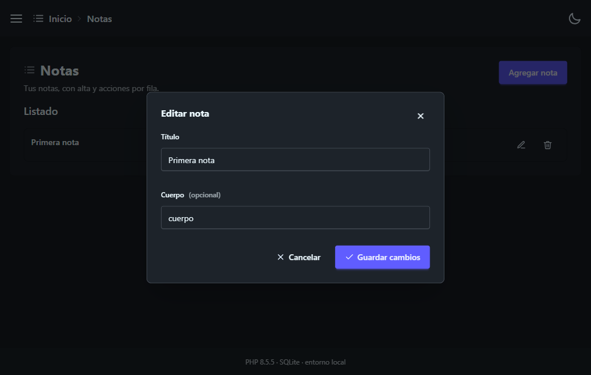

### 9.2 Guardar la edición

El modal muestra la nota correcta y el `action` ya apunta a `/notas/{id}`; del otro lado no hay nadie
escuchando. Este paso agrega `update()` y con él la otra mitad del contrato: validar, guardar y volver a
la lista con el aviso, o rechazar sin perder lo escrito.

**Archivo**: el mismo controlador, método `update()`.

**Acción**: agrega `update()`, que valida, guarda y vuelve a la lista:

```php
    public function update(Request $request, Response $response, array $args): Response
    {
        $nota = Nota::find((int) $args['id']);

        if ($nota === null) {
            throw new HttpNotFoundException($request, 'No existe una nota con ese identificador.');
        }

        $data = (array) $request->getParsedBody();
        $data['cuerpo'] = trim((string) ($data['cuerpo'] ?? ''));

        $validator = Validator::make($data, [
            'titulo' => 'required|max:120',
            'cuerpo' => 'max:2000',
        ]);

        if ($validator->fails()) {
            return $this->render($request, $response, 'notas/index.twig', [
                'notas'           => Nota::orderByDesc('id')->get(),
                'errors'          => $validator->errors(),
                'form_values'     => $data,
                'nota'            => $nota,
                'open_edit_modal' => true,
                'active'          => 'notas',
            ])->withStatus(422);
        }

        $nota->fill([
            'titulo' => (string) $data['titulo'],
            'cuerpo' => $data['cuerpo'] !== '' ? $data['cuerpo'] : null,
        ])->save();

        Flash::set('success', 'Nota actualizada.');

        return $response->withStatus(303)->withHeader('Location', Url::path('/notas'));
    }
```

La validación es la misma que en el alta, pero el rechazo conserva `nota` y `open_edit_modal`: sin esas
dos claves, el 422 renderiza la lista, el modal de edición no existe y lo tipeado termina en el modal
de alta. `form_values` repinta lo que el usuario escribió; `errors` muestra el mensaje en el campo.

**Comprobación**: abre el lápiz de una nota, cambia el título y guarda. Esperado: vuelves a la lista,
la fila muestra el título nuevo y aparece el aviso «Nota actualizada.». El rechazo se comprueba igual
que en 7.5 —el campo también lleva `required`, así que el navegador no deja enviarlo vacío—: con el
mismo POST por `curl` contra `/notas/{id}`, esperando 422, el modal de edición abierto, el error y el
cuerpo conservado.

**Falla si**:

- Guardar no cambia nada: el `action` del formulario no apunta a `/notas/{id}`, o el controlador no
  hace `save()`.
- El 422 abre el modal de alta: falta `nota` o `open_edit_modal` en el render de rechazo.
- Se pierde lo tipeado: falta `form_values`.
- El 404 sale como 500: no estás lanzando `HttpNotFoundException` antes de tocar la nota.

**Qué no prueba**: que dos personas editando a la vez no se pisen. No hay control de concurrencia, y
este recorrido no lo agrega.

**Qué ganaste**: editar funciona de punta a punta y reusa el formulario, el modal y las reglas del alta.
Y mira el costo: esas reglas quedaron escritas dos veces, en `store()` y en `update()`, con la misma
pareja de cadenas; el capítulo 13 unifica los renders, no las reglas.

**Pieza — reusar el modal para alta y edición**: resuelve el formulario una sola vez y evita dos
pantallas con reglas que se desincronizan. Úsalo cuando los campos son los mismos. Sin esto, el alta y
la edición validan distinto y una de las dos se olvida de algo.

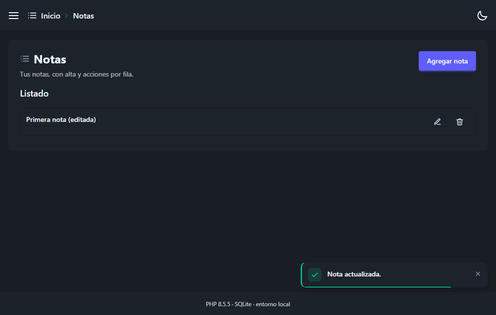

---

## 10. Borrar: del confirm del navegador al diálogo del proyecto

**Objetivo**: que borrar pida confirmación, entendiendo por qué el atajo del navegador no alcanza.

**Estado de partida**: paso 9 hecho; la papelera no hace nada.

### 10.1 Primero, el atajo

La papelera existe desde 8.2 y no hace nada: no hay ruta que la atienda. Borrar es la única operación del
recorrido que no tiene vuelta atrás, así que este paso la conecta de punta a punta con la confirmación
más barata que hay —la del navegador— antes de reemplazarla por una que diga qué se borra.

**Archivo**: `resources/views/notas/_panel.twig`, dentro del `<li>` del ``, en el lugar de la
papelera del paso 8.

**Acción**: envuelve la papelera en un formulario con el `confirm` del navegador:

```twig
<form method="post" action="{{ url('/notas/' ~ item.id ~ '/delete') }}"
      class="inline" onsubmit="return confirm('¿Borrar esta nota?')">
    
    
</form>
```

**Archivo**: `app/Http/Controllers/NotaController.php`, método `destroy()`.

**Acción**: agrega `destroy()`:

```php
    public function destroy(Request $request, Response $response, array $args): Response
    {
        $nota = Nota::find((int) $args['id']);

        if ($nota === null) {
            throw new HttpNotFoundException($request, 'No existe una nota con ese identificador.');
        }

        $nota->delete();

        Flash::set('success', 'Nota borrada.');

        return $response->withStatus(303)->withHeader('Location', Url::path('/notas'));
    }
```

**Comprobación**: toca la papelera. Aparece el cartel del navegador «¿Borrar esta nota?». Si aceptas,
la fila desaparece y el aviso «Nota borrada.» sale abajo a la derecha.

**Qué ganaste**: borrar funciona de punta a punta, y sabes exactamente por qué no alcanza. **Y sin
embargo no se queda**: `confirm()` es un cartel del sistema, no se puede estilar, no respeta el tema, no
dice **qué** nota estás borrando y bloquea el hilo del navegador. Por eso el proyecto usa un diálogo.

Sin captura: el `confirm()` es un diálogo del sistema y no se puede fotografiar desde el navegador; su texto es «¿Borrar esta nota?».

### 10.2 Ahora, el diálogo de confirmación

El atajo dejó la papelera envuelta en un `<form>`, así que el botón perdió el `data_modal_open` que el
paso 8.2 le había puesto. Recuperarlo no es sólo quitar el formulario: el diálogo tiene que existir una
vez por fila, con el id que el botón nombra, y vivir fuera de la lista sin descolocarla. Ese es el trabajo
del paso.

**Archivo**: `resources/views/notas/_panel.twig`, dentro del ``, después del `</li>` de la
fila.

**Acción**: desenvolvé la papelera y pon el diálogo justo después del `</li>`. El botón no se va: deja
de estar envuelto por el `<form>` y recupera `data_modal_open`, que es lo que el shell usa para abrir
el diálogo. La fila queda así:

```twig
            <li class="flex items-start justify-between gap-3 rounded-box border border-base-300 bg-base-100 p-3">
                <span class="font-semibold">{{ item.titulo }}</span>
                <div class="flex shrink-0 items-center gap-1">
                    {# … el lápiz de 8.2 … #}

                    
                </div>
            </li>
```

Y después de la `</ul>`, todavía dentro de `#notas-panel`, el diálogo. Va aquí y no dentro del
`<li>` porque un `<dialog>` no es hijo válido de una `<ul>`, y porque un hijo más del `flex` de la
fila la descoloca. Recorre las notas otra vez porque este bloque se emite una sola vez:

```twig
    </ul>
    
            
                
                    <p class="py-3 opacity-70">¿Borrar «{{ item.titulo }}»? No se puede deshacer.</p>
                    <form method="post" action="{{ url('/notas/' ~ item.id ~ '/delete') }}"
                          onsubmit="this.querySelector('[type=submit]').disabled = true">
                        
                        <div class="modal-action">
                            
                            
                        </div>
                    </form>
                
            
            
```

La papelera ya apunta a ese diálogo con `data_modal_open`; el shell llama a `showModal()` al tocarla.
Ese `id` lleva el número de fila: un id fijo abriría siempre el mismo diálogo, con el título de otra
nota.

**Comprobación**: toca la papelera de una nota. Esperado: se abre un diálogo que dice **qué nota** vas
a borrar —«¿Borrar «Comprar pan»? No se puede deshacer.»—, con «Cancelar» y «Borrar». «Cancelar» no
hace nada; «Borrar» elimina la fila y muestra el aviso.

**Qué ganaste**: el texto dice qué se borra, el diálogo respeta el tema y el foco, y cancelar es una
acción explícita en vez de cerrar un cartel del sistema.

**Falla si**:

- La papelera no abre nada: el `data_modal_open` apunta a un id que no existe (el id lleva el número de fila).
- Cancelar borra igual: el botón de cancelar tiene que ser `type: 'button'`; con `submit` el formulario
  se envía.
- El borrado te devuelve al login con «Tu sesión expiró»: falta el ``
  dentro del formulario del modal. Sin HTMX el rechazo es un 303 al login; el 400 con `HX-Trigger` es
  sólo para disparadores HTMX.

**Qué no prueba**: que el borrado sea reversible, ni que exista borrado lógico. Borra la fila.

**Pieza — confirmación en un diálogo antes de mutar**: resuelve el «¿estás seguro?» con el idioma del
proyecto. Úsala en toda acción destructiva. Evita el borrado por accidente y el cartel del sistema que
no dice qué se borra. Sin esto, la papelera borra al primer toque y no hay vuelta atrás.

> **Por qué un diálogo por fila y no uno solo**: el demo de contactos usa un único modal y le cambia
> el `action` por JavaScript. Aquí el diálogo vive en cada fila para no agregar JS: es más markup, pero
> es server-rendered y no depende de estado del cliente. Con decenas de filas, el modal único con JS
> vuelve a tener sentido.

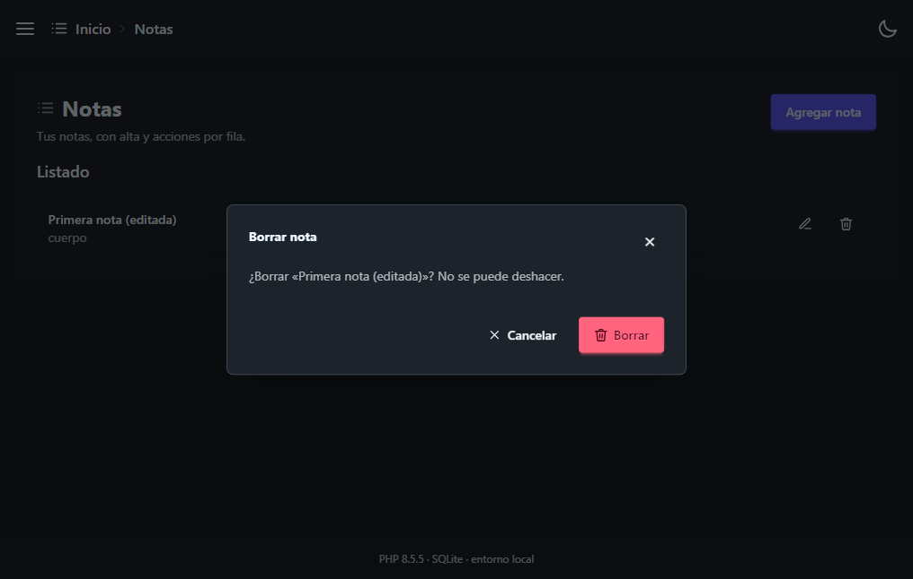

---

## 11. Tests que reemplazan lo que hacías a mano

**Objetivo**: convertir en automático lo que venías comprobando a mano.

**Estado de partida**: pasos 1 a 10 hechos y comprobados en pantalla.

Todo lo que comprobaste hasta aquí fue a mano y no quedó registrado: si mañana cambias el controlador, el
único que lo nota eres tú, y sólo si repites las visitas. Los tests convierten esas comprobaciones en algo
que corre en segundos —el 303 del alta, el 422 con lo tipeado, el 404 del id inexistente— y ese es el piso
que necesita cualquier cambio posterior.

**Acción**: crea `tests/Http/NotaTest.php`:

```php
<?php

declare(strict_types=1);

namespace Tests\Http;

use App\Models\Nota;
use Tests\Support\HttpTestCase;

final class NotaTest extends HttpTestCase
{
    protected function setUp(): void
    {
        self::loginAs();
        Nota::query()->delete();
    }

    protected function tearDown(): void
    {
        Nota::query()->delete();
        parent::tearDown();
    }

    private function crear(array $datos = []): Nota
    {
        // `$datos` primero: con el default a la izquierda, el `+` de PHP
        // descarta el título que pasa cada test y todas las filas se llaman
        // «De prueba». El test igual pasa si sólo comprueba el estado final.
        return Nota::create($datos + ['titulo' => 'De prueba']);
    }

    public function test_crea_una_nota_y_la_muestra_en_la_lista(): void
    {
        $token = self::token('/notas');

        $response = self::app()->handle(self::request('POST', '/notas', [
            'csrf_name'  => $token['csrf_name'],
            'csrf_value' => $token['csrf_value'],
            'titulo'     => 'Primera nota',
            'cuerpo'     => 'Contenido',
        ]));

        self::assertSame(303, $response->getStatusCode());
        self::assertSame('/notas', $response->getHeaderLine('Location'));
        self::assertSame(1, Nota::query()->count());

        $lista = self::app()->handle(self::request('GET', '/notas'));
        self::assertStringContainsString('Primera nota', (string) $lista->getBody());
        self::assertStringContainsString('aria-current="page">Notas', (string) $lista->getBody());
    }

    public function test_el_alta_invalida_reabre_el_modal_con_lo_tipeado(): void
    {
        $token = self::token('/notas');

        $response = self::app()->handle(self::request('POST', '/notas', [
            'csrf_name'  => $token['csrf_name'],
            'csrf_value' => $token['csrf_value'],
            'titulo'     => '',
            'cuerpo'     => 'Texto que quiero conservar',
        ]));
        $html = (string) $response->getBody();

        self::assertSame(422, $response->getStatusCode());
        self::assertSame(0, Nota::query()->count());
        self::assertStringContainsString('Este campo es obligatorio.', $html);
        self::assertStringContainsString('Texto que quiero conservar', $html);
        self::assertMatchesRegularExpression('/nota-create-modal[^>]*open/', $html);
    }

    public function test_edita_una_nota(): void
    {
        $nota = $this->crear(['titulo' => 'Antes']);
        $token = self::token('/notas');

        $response = self::app()->handle(self::request('POST', '/notas/' . $nota->id, [
            'csrf_name'  => $token['csrf_name'],
            'csrf_value' => $token['csrf_value'],
            'titulo'     => 'Después',
        ]));

        self::assertSame(303, $response->getStatusCode());
        self::assertSame('Después', (string) Nota::find($nota->id)?->titulo);
    }

    public function test_borra_una_nota_con_confirmacion(): void
    {
        $nota = $this->crear();
        $token = self::token('/notas');

        $response = self::app()->handle(self::request('POST', '/notas/' . $nota->id . '/delete', [
            'csrf_name'  => $token['csrf_name'],
            'csrf_value' => $token['csrf_value'],
        ]));

        self::assertSame(303, $response->getStatusCode());
        self::assertNull(Nota::find($nota->id));
    }

    public function test_avisa_cuando_el_identificador_no_existe(): void
    {
        $response = self::app()->handle(self::request('GET', '/notas/99999/edit'));
        $html = (string) $response->getBody();

        self::assertSame(404, $response->getStatusCode());
        self::assertNotSame('', $html, 'Un 404 mudo no avisa nada.');
        self::assertLessThan(4096, strlen($html), 'Un 404 no debería gastar la página de depuración.');
    }
}
```

**Comprobación**:

```bash
vendor/bin/phpunit --filter NotaTest
```

Esperado: cinco tests en verde. En 13.3 se suma el sexto, el del 422 con `HX-Push-Url`.

**Falla si**:

- El test falla en `Location` (`/login` en vez de `/notas`): el token no está llegando, aunque el
  primer `assertSame(303, …)` pase igual. Sin HTMX el rechazo de CSRF es un 303 al login, no un 400.
  `HttpTestCase::token()` te da el par.
- El test del modal falla en el `assertMatchesRegularExpression`: el atributo `open` no está saliendo; revisa `open_create_modal`.
- La suite completa falla después: falta el `tearDown` que limpia `notas`.

**Qué no prueba**: que la pantalla se vea bien, ni que los diálogos abran. Prueba el contrato HTTP:
qué código, qué guarda y qué mensaje.

> **Checkpoint**: aquí tienes la entidad completa —crear, editar, borrar con confirmación y tests—. Si
> esto no funciona, lo que sigue no lo arregla.

**Qué ganaste**: cinco casos que antes comprobabas a mano ahora fallan solos cuando algo se rompe, y
corren con el mismo comando que el resto de la suite. El límite es el del contrato: los tests miran
códigos, filas y mensajes, no markup, así que el HTML puede cambiar sin que ninguno se queje. Extraer con
esa red es el paso siguiente.

**Pieza — `Tests\Support\HttpTestCase`**: resuelve el arranque de la app, la sesión inyectada, el
request con cuerpo de formulario y los tokens (`token()`). Úsalo como base de todos tus tests HTTP.
Evita tests que arman el entorno a mano y se rompen cuando cambia el bootstrap.

Sin captura: este paso no cambia la pantalla, cambia lo que la comprueba.

---

## 12. Extraer la lista a un componente

**Objetivo**: sacar de tu panel el `<ul>`, el recorrido y el estado vacío. Te quedas sólo con la fila.

**Estado de partida**: paso 11 hecho; la entidad funciona y los tests están en verde.

Hasta aquí el `<ul>`, el recorrido y la fila viven en `_panel.twig`. Eso está bien mientras hay una
sola pantalla: se lee de arriba abajo y no esconde nada. El problema aparece cuando quieres repetir el
listado en otra entidad o cuando el estado vacío se desincroniza entre pantallas. El proyecto ya tiene
esa pieza resuelta: `components/list/simple.twig`.

**Qué hace el componente**

**Componente**: `resources/views/components/list/simple.twig`. Léelo, no lo edites: ya existe y es del
proyecto.

```twig
{# Lista simple con estado vacío.
   Props: items, empty, list_class, empty_class.
   El bloque `row` se renderiza una vez por item y recibe `item`; el markup de
   cada fila queda en el dominio que lo usa.
   El bloque `after` se emite DESPUÉS del `</ul>`: es donde van los diálogos de
   cada fila. Un `<dialog>` es hijo inválido de una `<ul>` —sólo admite `<li>` y
   elementos de soporte de script—, así que el componente reserva ese lugar en
   vez de obligar a meterlo adentro de la fila. #}
<ul class="{{ list_class|default('space-y-2') }}">
    
        
    
        <li class="{{ empty_class|default('opacity-60') }}">{{ empty|default('No hay registros todavía.') }}</li>
    
</ul>

```

**Qué hace cada pieza**:

- `<ul class="{{ list_class|default('space-y-2') }}">`: el componente es dueño del contenedor.
  `list_class` es opcional; si no lo pasas, usa `space-y-2`. `default` **reemplaza** el valor, no lo
  fusiona: para agregar una clase tienes que repetir `space-y-2`.
- ``: recorre la colección que le pases. `item` es cada elemento.
- ``: un bloque vacío es un punto de extensión. Ahí entra tu fila. Está
  **dentro del `for`**, así que tu fila ve el `item` de esa vuelta.
- ``: pertenece al `for`. Se ejecuta cuando `items` está vacío, sin agregar un ``
  alrededor de todo.
- ``: se emite **después** del `</ul>`. Ahí van los diálogos por fila:
  un `<dialog>` no es hijo válido de una lista, así que el componente no te deja meterlo en la fila.
  Este bloque se pinta una sola vez y no recibe `item`; si necesitas uno por fila, recorre `items`
  tú.
- `{{ empty|default('No hay registros todavía.') }}` dentro de un `<li>`: el estado vacío ocupa una
  fila más de la lista; `empty_class` es su clase opcional.

El componente no sabe nada de `notas` ni de `titulo`: sólo sabe recorrer y dejar un hueco. Eso es lo
que lo hace reusable, y también lo que lo vuelve difícil de leer la primera vez.

**Cómo se rellena el hueco**: ya lo hiciste con el modal. En 7.4 reemplazaste el `<dialog>` por
`components/ui/modal.twig` y escribiste un ``; el modal puso el resto. Aquí es el mismo
`embed`, con una diferencia: `row` se rellena **una vez por item**, porque el componente lo invoca
dentro de su `for`.

Para verlo sin el ruido de los botones, toma la fila mínima de 6.6:

```twig
<div id="notas-panel">
    <ul class="space-y-2">
        
            <li class="rounded-box border border-base-300 bg-base-100 p-3">
                <span class="font-semibold">{{ item.titulo }}</span>
            </li>
        
            <li class="opacity-60">No hay notas todavía.</li>
        
    </ul>
</div>
```

El equivalente con el componente es:

```twig
<div id="notas-panel">
    
        
            <li class="rounded-box border border-base-300 bg-base-100 p-3">
                <span class="font-semibold">{{ item.titulo }}</span>
            </li>
        
    
</div>
```

**Qué hace cada línea del `embed`**:

- `embed 'components/list/simple.twig'`: incluye el componente y te deja reemplazar sus bloques. Un
  `include` común no puede: copia el componente tal cual y el bloque `row` quedaría vacío.
- `with { items: notas, empty: '…' }`: pasa variables al scope del componente. `items` alimenta su
  `for`; `empty` es el texto de su `else`.
- ``: rellena el bloque vacío. Se renderiza **donde el componente lo invoca**, o sea
  dentro de ``; por eso `item` es la nota de esa vuelta.
- ``: cierra el `embed`, no un `include`.

**El orden de render**: `embed` carga el componente; el componente abre el `<ul>`; recorre `items` y,
en cada vuelta, llega al ``, donde pinta tu fila con el `item` de esa vuelta. Si
`items` está vacío, el `else` pinta el vacío y tu bloque no se ejecuta.

**La inversión**: compara los dos bloques. Producen el mismo HTML, pero en el segundo tu archivo no
tiene el `<ul>`, ni el `for`, ni el `else`, y aun así el `<li>` se repite una vez por nota. El
componente pone la estructura y el vacío; tú sólo describes una fila. Desconcierta la primera vez
porque la indentación sugiere que el `<li>` se pinta una vez, cuando en realidad se repite.

**Falla si** (cuando lo apliques):

- La lista aparece vacía aunque haya notas: usaste `include` en vez de `embed`, o el
  `` quedó fuera del `embed`.
- Las filas salen vacías: escribiste `{{ item }}` en vez de `{{ item.titulo }}`.
- Aparece «No hay registros todavía.» en vez de tu texto: `empty` no está llegando al componente.
- La lista no aparece: el nombre del componente no coincide con `components/list/simple.twig`.

**Qué ganaste**: sabes qué parte de tu fila va en cada bloque y por qué el `<li>` se repite sin un `for`
tuyo. El panel, mientras tanto, sigue con su propio `<ul>` y su propio estado vacío. Ese es el trabajo
que sigue.

**Mover la fila completa**

El panel funciona y no hace falta reescribirlo: hay que cortarlo por donde el componente espera. El corte
no es de contenido sino de responsabilidad —qué se queda en tu archivo y qué pasa al componente—, y por
eso el paso no muestra un fragmento: muestra el archivo entero antes y después.

**Archivo**: `resources/views/notas/_panel.twig`.

**Antes**: el `<div id="notas-panel">` con el `<ul>`, el ``, el `<li>` con los dos botones, el
bloque de diálogos después de la `</ul>` y el `` del vacío.

**Regla**: lo que está entre `<li>` y `</li>` —título y botones— va adentro de ``. El
recorrido de diálogos que sigue a la `</ul>` va adentro de ``: el componente lo emite en
ese mismo lugar. Lo único que desaparece es el `<ul>`, el ``, el `` y el `<li>` del
vacío: eso ya lo pone el componente.

**Después**: el archivo completo queda así.

```twig
<div id="notas-panel">
    
        
            <li class="flex items-start justify-between gap-3 rounded-box border border-base-300 bg-base-100 p-3">
                <div class="min-w-0">
                    <a class="font-semibold" href="{{ url('/notas/' ~ item.id ~ '/edit') }}">{{ item.titulo }}</a>
                    
                        <p class="text-sm opacity-70">{{ item.cuerpo }}</p>
                    
                </div>
                <div class="flex shrink-0 items-center gap-1">
                    

                    
                </div>
            </li>
        

        {# Los diálogos van en `after`, fuera de la `<ul>`. Recorren `notas` otra
           vez porque este bloque se emite una sola vez, sin `item`. #}
        
            
                
                    
                        <p class="py-3 opacity-70">¿Borrar «{{ item.titulo }}»? No se puede deshacer.</p>
                        <form method="post" action="{{ url('/notas/' ~ item.id ~ '/delete') }}"
                              onsubmit="this.querySelector('[type=submit]').disabled = true">
                            
                            <div class="modal-action">
                                
                                
                            </div>
                        </form>
                    
                
            
        
    
</div>
```

**Dos detalles que importan**:

- Los diálogos van en `after`, no dentro de la fila: adentro serían un hijo más del `flex` y
descolocarían la fila, y además un `<dialog>` no es hijo válido de la `<ul>`. `after` se emite después
del cierre, así que cada nota necesita su vuelta: de ahí el `` propio.
- `block row` es la única parte de tu archivo que se repite por nota. Si copias el
  `<div id="notas-panel">` adentro del bloque, el id se duplica y HTMX deja de saber qué reemplazar.

**Y dos cambios en la fila, para cerrar la diferencia con el demo**: el título pasa a ser un enlace a
editar —un blanco más grande que el lápiz, útil en el móvil— y debajo aparece el `cuerpo` cuando existe.
El `cuerpo` lo vienes guardando desde el capítulo 7 y hasta ahora no se veía en ninguna parte: una nota
con cuerpo y otra sin él se veían igual. El lápiz se queda; los dos caminos llevan al mismo modal.

**Comprobación**: la lista se ve como en el paso 10 salvo los dos cambios de la fila —título enlazado y
`cuerpo` visible—, y sigue igual con y sin notas; el lápiz abre el modal de edición; la papelera abre el
diálogo que dice **qué nota** vas a borrar; borrar elimina una sola nota; `composer test` sigue en verde.

**Falla si**:

- Con notas, la lista se ve vacía: el `` quedó fuera del `embed` o el `embed` apunta a
  otro nombre.
- La papelera no abre nada: el modal quedó fuera del `` (o del `for`) y el id no
  coincide con `data_modal_open`.
- La fila se descoloca: el modal quedó dentro del `<li>` y entró en el `flex`.
- «No hay notas todavía.» no aparece: `empty` no está llegando.

**Qué no prueba**: que el HTML sea idéntico carácter por carácter. `composer test` prueba el contrato
HTTP —códigos, datos guardados, mensajes—, no el markup. La comparación visual la haces tú.

**Qué ganaste**: el panel ya no sabe cuántas filas hay ni qué pasa si no hay ninguna; sólo describe una
fila. La próxima entidad que hagas puede reusar el componente sin copiar el `<ul>` ni el vacío.

**Pieza — `components/list/simple.twig`**: resuelve el `<ul>`, el recorrido y el estado vacío. Úsalo
para todo listado simple. Evita repetir el mismo bucle en cada pantalla y olvidarte del vacío. Sin él,
cada entidad tiene su propia versión con variaciones accidentales.

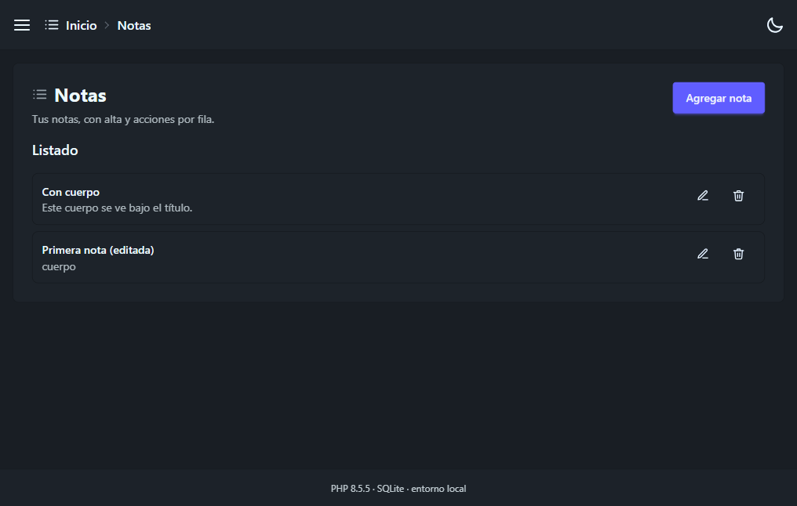

---

## 13. Paginación del servidor

**Objetivo**: que la lista siga siendo usable cuando crezca.

**Estado de partida**: paso 12 hecho; con muchas notas la página se vuelve larga.

### 13.1 Paginar la consulta

La lista trae todo lo que hay en la tabla, y con cien notas la página tarda y el scroll no termina.
Recortar en el navegador no sirve: el HTML ya viajó. La paginación tiene que ocurrir en el servidor,
sobre la consulta, y este paso la agrega sin tocar todavía la vista.

**Archivo**: `app/Http/Controllers/NotaController.php`.

**Acción**: suma `use Framework\Http\Pagination;` y centraliza la lectura en un método privado:

```php
    private function pageData(Request $request): array
    {
        $query = $request->getQueryParams();

        $paginacion = Pagination::paginate(
            Nota::orderByDesc('id'),
            (int) ($query['page'] ?? 1),
            (int) ($query['per_page'] ?? Pagination::DEFAULT_PER_PAGE),
            Url::path('/notas')
        );

        return [
            'notas'       => $paginacion['items'],
            'pagination'  => $paginacion,
            'breadcrumbs' => [
                ['label' => 'Inicio', 'href' => Url::path('/')],
                ['label' => 'Notas', 'icon' => 'list', 'current' => true],
            ],
        ];
    }
```

`Pagination::paginate()` recibe la consulta, la página pedida, el tamaño y la URL base. Devuelve los
items de esa página y los datos que después usan los controles —incluido el total, que la paginación
muestra por su cuenta—. `pageData()` traduce eso a las variables que ya conoce la vista. `breadcrumbs` viaja acá y no en `index()` para que el parcial de
HTMX y los rechazos también lo lleven: si se quedara en `index()`, la región devuelta por HTMX perdería
la miga.

**Archivo**: el mismo controlador, método `index()`.

Ahora `index()` usa ese helper:

```php
    public function index(Request $request, Response $response): Response
    {
        return $this->render($request, $response, 'notas/index.twig', $this->pageData($request) + [
            'active' => 'notas',
        ]);
    }
```

Todavía no toques la vista ni el helper de respuesta: primero comprobamos que el servidor recorta bien.

**Comprobación**: con más de diez notas, abre directamente `/notas?page=2&per_page=10`. Esperado: ves
las notas 11 a 20, y la paginación dice «Mostrando 11 al 20 de N registros». `?page=1&per_page=25` muestra hasta 25; una página fuera de rango
se ajusta a la última. Los controles visuales todavía no están; eso es 13.2.

**Qué no prueba**: que los controles naveguen sin recargar. Prueba que la consulta y el recorte del
servidor son correctos.

**Falla si**:

- Ves todas las notas en una sola página: `index()` sigue usando `get()` o `Pagination` no recibe la
  consulta.
- El rango de la paginación no coincide: `Pagination` cuenta la tabla entera, no la página; si el
  número no cambia al moverte, la consulta que le pasaste ya venía recortada.
- Una página negativa o enorme rompe: `Pagination` normaliza, pero la página tiene que venir de la query,
  no de un valor fijo.

**Qué ganaste**: la consulta se recorta y el total es el de la tabla, no el de la página, así que la
paginación podrá decir la verdad cuando existan sus controles. Lo que falta se ve en pantalla: todavía no
están, y la única forma de cambiar de página es escribir la query a mano.

**Pieza — `Framework\Http\Pagination`**: resuelve conteo, recorte y página actual del lado del servidor.
Úsalo en toda lista que pueda crecer. Evita el `get()` pelado, que funciona con veinte filas y se cae
con dos mil.

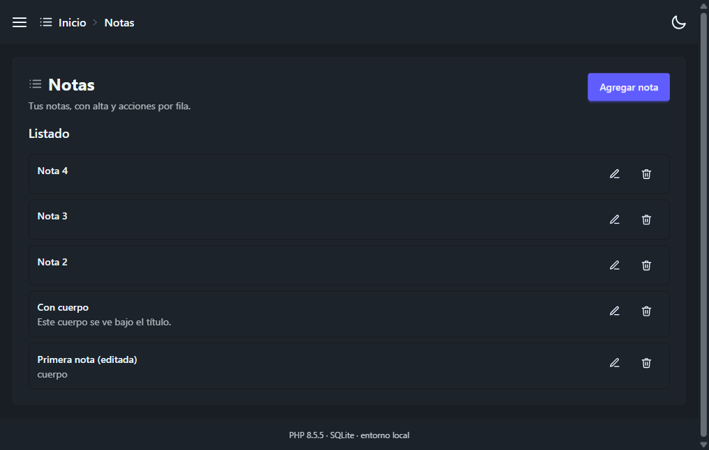

### 13.2 Pintar los controles y responder sólo el panel

El servidor ya recorta, pero la vista no lo sabe: recibe diez notas y no tiene con qué pedir las
siguientes. Este paso pinta los controles y, al mismo tiempo, resuelve lo que aparece al usarlos —con
HTMX cada clic reemplaza la región, así que la respuesta tiene que ser la región y no la página entera—.
Las dos cosas van juntas o el swap rompe el shell.

**Archivo**: el mismo controlador.

**Acción**: crea `renderIndex()`, que arma la página y decide qué devolver según el pedido:

```php
    private function renderIndex(Request $request, Response $response, array $extra = [], int $status = 200): Response
    {
        $data = $this->pageData($request);

        // Con HX-Request va SÓLO la región. Si devuelves la página entera, el
        // swap mete el shell del layout adentro del panel: dos sidebars, dos
        // headers y el contenido duplicado.
        $template = $request->hasHeader('HX-Request') ? 'notas/_panel.twig' : 'notas/index.twig';

        $rendered = $this->render($request, $response, $template, $data + $extra + [
            'active' => 'notas',
        ])->withStatus($status);

        if ($status >= 400) {
            return $rendered;
        }

        return $rendered->withHeader('HX-Push-Url', Url::path('/notas')
            . '?page=' . $data['pagination']['current_page']
            . '&per_page=' . $data['pagination']['per_page']);
    }
```

**Archivo**: el mismo controlador, método `index()`.

`index()` queda en una línea:

```php
    public function index(Request $request, Response $response): Response
    {
        return $this->renderIndex($request, $response);
    }
```

La clave está en `HX-Request`: un pedido normal recibe `index.twig` completo; un pedido de HTMX recibe
sólo `_panel.twig`. Si devuelves la página completa a HTMX, el panel se reemplaza por **otra página
completa** y el shell queda anidado: dos sidebars, dos headers y el contenido duplicado.

**Archivo**: `resources/views/notas/_panel.twig`, dentro de `div#notas-panel`, después del `embed` y
antes de cerrar el `div`.

**Acción**: agrega los controles:

```twig
    

    
</div>
```

Si dejas los controles fuera del parcial, el primer swap reemplaza el panel y los controles quedan
apuntando a un id que sigue existiendo pero ya no se actualiza.

**Pieza — `components/pagination/simple.twig`**: resuelve los controles, los estados deshabilitados y
el selector de tamaño. Úsalo con `pagination` y un `target` que apunte a la región que se va a
reemplazar. Evita rearmar los mismos botones en cada lista y desincronizar la página actual.

`HX-Push-Url` se emite sólo si el estado es 2xx: la URL del historial tiene que representar una página
que el usuario realmente navegó, no un 422 con errores. El guard `status >= 400` deja esa decisión en un
solo lugar.

**Comprobación**: crea más de diez notas. Esperado: se ven diez, con los controles debajo
(Primera/Anterior, números, Siguiente/Última) y el selector de tamaño.

Probalos uno por uno: cambiar el tamaño a 25 muestra las 25 que haya y actualiza la URL; «Última» va a
la última página con las filas que queden; «Anterior» y «Primera» retroceden; en los extremos, los
botones que no aplican salen deshabilitados. En todos los casos la página **no se recarga** y queda
**un solo** sidebar y **un solo** header.

Comprueba con el inspector después de paginar, pero contando en la **página entera**: tiene que haber
un solo `<header>` y dos `<aside>` —el sidebar y la nota del pie—, y `#notas-panel` tiene que seguir
existiendo con la paginación adentro. Los avisos son un `<div class="toast-host">`, no un `<aside>`; no
lo cuentes. Cuenta **elementos**, no coincidencias de texto: hay un `<aside>` escrito dentro de un
comentario de JS que no es parte del DOM. Si ves dos headers y cuatro asides, el servidor mandó la página
completa: el shell queda **al lado** del panel y no adentro, así que mirar sólo `#notas-panel` no
muestra nada raro y el bug pasa igual.

La cabecera se emite con la página que el **servidor** recortó, no con la que pidió el cliente: si
alguien pide `?page=99` sobre tres páginas, la URL que queda es la 3.

**Qué no prueba**: que un 422 no empuje la URL, ni que la edición siga abriendo su modal. Eso se cierra
en 13.3.

**Falla si**:

- La paginación no navega: el `div` con el id quedó fuera del parcial y el primer swap se lo llevó.
- Paginas y la URL no cambia: falta `HX-Push-Url`.
- Después de paginar ves **dos** sidebars o dos headers: el servidor devolvió la página completa a un
  request de HTMX, y el shell entró dentro del panel. Es el error más visible de este paso.
- Cambias el tamaño y vuelves a la página 1: es lo esperado al cambiar el tamaño; si no quieres eso, se
  decide en el componente.
- Todo aparece en una página: no estás pasando `pagination` a la vista.

**Qué ganaste**: la lista navega sin recargar, los controles viajan con el panel en cada swap y la URL del
historial dice la página que el servidor sirvió. Y mira el costo: `edit()` y los dos rechazos del
formulario arman a mano su propia copia de `notas` y `active`, que ahora viene paginada.
Unificarlos es 13.3.

**Pieza — `HX-Push-Url`**: resuelve la URL honesta después de un swap 2xx. Úsalo en toda región paginada
o filtrada. Evita que recargar o compartir el enlace te devuelva a otra página. No la emitas en un 422:
esa respuesta sólo repinta el formulario.

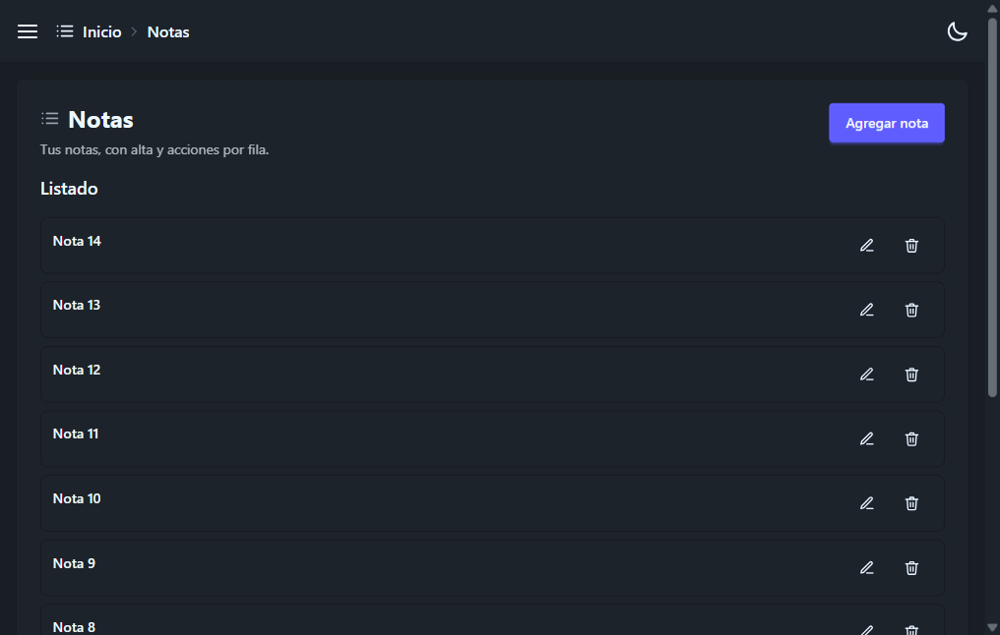

### 13.3 Unificar los renders de edición y 422

Los renders del listado están repetidos en tres métodos, y la repetición ya tiene un costo concreto: cada
uno decide por su cuenta si empuja `HX-Push-Url`, si pasa `active` y en qué estado devuelve la página. Con
un solo camino, esa decisión vive en un lugar y el 422 no puede olvidarse de nada.

**Archivo**: `app/Http/Controllers/NotaController.php`, métodos `edit()`, `store()` y `update()`.

**Acción**: reemplaza los renders sueltos de `edit()` y de los rechazos por `renderIndex()`, pasando lo
propio en `$extra`:

```php
        // edit()
        return $this->renderIndex($request, $response, [
            'nota'            => $nota,
            'open_edit_modal' => true,
        ]);

        // rechazo del alta
        return $this->renderIndex($request, $response, [
            'errors'            => $validator->errors(),
            'form_values'       => $data,
            'open_create_modal' => true,
        ], 422);

        // rechazo de la edición
        return $this->renderIndex($request, $response, [
            'errors'          => $validator->errors(),
            'form_values'     => $data,
            'nota'            => $nota,
            'open_edit_modal' => true,
        ], 422);
```

En el rechazo de la edición, `'nota' => $nota` no es decorativo: `index.twig` envuelve el modal de
edición en ``. Sin esa clave el modal no se renderiza y lo tipeado aparece en
el modal de alta, que es el que queda abierto.

El `422` pasa por el mismo `renderIndex()`, pero el guard de estado evita `HX-Push-Url`. Para fijar ese
contrato, agrega a `tests/Http/NotaTest.php`:

```php
    public function test_un_422_no_empuja_la_url(): void
    {
        $token = self::token('/notas');

        $response = self::app()->handle(self::request('POST', '/notas', [
            'csrf_name'  => $token['csrf_name'],
            'csrf_value' => $token['csrf_value'],
            'titulo'     => '',
            'cuerpo'     => '',
        ]));

        self::assertSame(422, $response->getStatusCode());
        self::assertSame('', $response->getHeaderLine('HX-Push-Url'));
    }
```

**Comprobación**: el test de 422 pasa; el alta inválida reabre su modal con errores; la edición inválida
reabre el modal de edición con la nota y lo tipeado; la paginación 2xx sigue empujando la URL.

**Qué no prueba**: que el orden sea el correcto entre páginas; lo define tu `orderBy`. Tampoco prueba la
navegación sin JavaScript: los enlaces llevan `href` real, pero el `<noscript>` del selector es otra cosa.

**Falla si**:

- Un 422 deja `HX-Push-Url`: el guard `status >= 400` no está o el estado no se pasa a `renderIndex()`.
- El modal de edición desaparece en un 422: falta `nota` en `$extra`.
- El alta inválida se abre en el modal de edición: sobra `nota` o `open_edit_modal` en el rechazo del
  alta.
- El test falla con 200: el título vacío no está llegando al validador o el token CSRF no es válido.

**Qué ganaste**: hay un método que arma la página, elige el parcial y decide la cabecera, y los tres casos
lo llaman con lo suyo. Lo que queda afuera es deliberado: las reglas de validación siguen en `store()` y
en `update()`, porque no son parte del render.

**Pieza — un solo camino de render**: resuelve la página, el parcial, el estado y la cabecera en un
único lugar. Úsalo en toda acción que renderice el listado. Evita que el alta, la edición y la
paginación tengan cada una su propia copia de `notas` y `active`.

---

## 14. Repetir el patrón con otra entidad

**Objetivo**: aplicar el mismo camino a una entidad propia.

**Estado de partida**: pasos 1 a 13 hechos.

El recorrido funcionó una vez, sobre `notas`. Lo que se repite no es esa entidad sino el patrón: qué
archivos aparecen siempre, qué cambia con el dominio y en qué orden se comprueban. Este capítulo lo deja
escrito para que la segunda entidad no te obligue a releer los trece anteriores.

| Qué cambia | Qué no cambia |
|---|---|
| El nombre de la entidad y de la tabla | El orden de los pasos |
| Los campos y sus reglas de validación | Los modales de alta, edición y borrado |
| El contenido de la fila | Las acciones por fila con nombre accesible |
| Los textos visibles | La lista en `components/list/simple.twig` |
| Los datos de los tests | La paginación del servidor y `HX-Push-Url` |
| La cantidad de registros de prueba | El encabezado en `components/ui/page-header.twig` |
| El icono y el subtítulo del encabezado | Los seis casos del cierre |

**Los archivos a tocar**, en orden:

1. `database/migrations/NNN_create_<entidad>_table.php`. Toma el siguiente número libre de
   `database/migrations/`, nunca `007` ni `008`: esas versiones las reservan los demos de notas y
   contactos desde `framework/scaffolds/*/database/migrations/<demo>/`.
2. `app/Models/<Entidad>.php`
3. `routes/<entidad>.php` (el arranque lo carga solo, con `->add(RequireAuthMiddleware::class)` en el
   grupo; sin eso tu CRUD queda público) y `config/navigation/<entidad>.php`
4. `app/Http/Controllers/<Entidad>Controller.php`
5. `resources/views/<entidad>/index.twig`, `_panel.twig`, `_form.twig`
6. `tests/Http/<Entidad>Test.php`

Para el icono del encabezado y del menú usa un nombre del registro compartido —los de
`resources/views/partials/_icon.twig`, que ya incluyen `list`, `contacts`, `pencil` y `trash`—: un nombre
que no existe no rompe nada pero **no pinta nada**, ni el svg del `<h1>` ni el del sidebar. Si necesitas
un glifo nuevo, agrégalo ahí primero.

**Sobre el demo como punto de comparación**: `composer demo:notas:install` instala una entidad `notas`
con el mismo nombre de tabla y la misma clase de migración que acabas de escribir, así que **no convive
con tu versión**: el instalador aborta, o con `--force` copia los archivos y después revierte todo
porque la tabla ya existe. Para comparar, usa un clon limpio sin la entidad —o el demo antes de
empezar—. Es la misma entidad, no dos que puedan estar juntas.

**Comprobación**: elige otra entidad (por ejemplo `libros`, con `titulo` y `anio`) y recorre esa lista.
Esperado: al terminar, la pantalla tiene botón de alta en un modal, acciones por fila, borrado con
confirmación, paginación y seis tests en verde.

**Falla si**:

- El modal de borrado no abre: `data_modal_open` apunta a un id sin el número de fila.
- El alta inválida no reabre el modal: falta pasar `open_create_modal`.
- La paginación deja de funcionar después del primer guardado: el `div` del panel quedó fuera del parcial.

**Qué no prueba**: que el patrón sirva para entidades con relaciones, permisos por fila o adjuntos.
Eso es otra conversación, y necesita más piezas.

**Qué ganaste**: tienes el orden, los archivos y las piezas fijas, así que la segunda entidad es cuestión
de reemplazar nombres y campos en vez de decidir de nuevo. Y tienes una salida cuando algo no encaja: la
tabla de problemas frecuentes nombra el síntoma y el paso donde se arregla.

---

## Problemas frecuentes

| Síntoma | Causa probable | Solución |
|---|---|---|
| El POST te devuelve al login con «Tu sesión expiró» | Falta el token de CSRF en el formulario | `` dentro del `<form>` |
| El login vuelve al formulario con «Credenciales inválidas.» | Email o contraseña no coinciden con el admin sembrado | Vuelve a sembrar con las mismas variables; el mensaje es genérico a propósito |
| `no such table` | Migración no aplicada en la base que usa la app | `vendor/bin/phinx status` y revisa `DB_DATABASE` |
| El aviso de éxito no aparece | Falta `usesToastFlash()` en el controlador | Pasa el método a `true` |
| El modal abre cerrado tras un rechazo | No estás pasando `open_create_modal` / `open_edit_modal` | Pásalo en `true` en el render del 422 (pasos 7.5 y 9.2) |
| El error no aparece junto al campo | El include del `field` usa `only` y no recibe `error` | Pasa `error: errors.<campo>|default(null)` |
| El alta vuelve al login sin ningún aviso | El `include` de `_form.twig` lleva `only` y los campos CSRF salen vacíos | Quita el `only` de ese include: el parcial necesita el contexto de CSRF del `render()` |
| El panel desaparece tras el primer guardado | El `div` con el id quedó en `index.twig` | Muévelo adentro del parcial (paso 6.6) |
| La papelera no abre el diálogo | El `data_modal_open` apunta a un id sin el número de fila | Usa `nota-delete-{id}` en el modal y en `data_modal_open` |
| La lista se ve vacía aunque haya notas | El componente se incluyó con `include` y el bloque `row` no se rellena | Usa `embed` y pon la fila en `` (capítulo 12) |
| La papelera no abre nada | El modal quedó fuera del bloque `row` | Muévelo adentro del bloque, después del `</li>` (capítulo 12) |
| La lista trae todo | Falta `Pagination::paginate()` | Paso 13.1 |
| Paginas y la URL no cambia | Falta la cabecera `HX-Push-Url` | Paso 13.2 |
| Editar un id inexistente da 500 | No se lanza `HttpNotFoundException` | Paso 9.1 |

## Qué demuestra este recorrido

Que agregar una entidad a este framework tiene un orden, y que ese orden tiene comprobaciones. Las
piezas que usaste —migraciones, modelo, archivo de rutas, `render()`, validador, CSRF, `layouts/app.twig`,
`components/list`, `components/form`, `components/ui/{button,modal,page-header}`, paginación, `HttpTestCase`— no
son opcionales: son el idioma del proyecto.

Y que ese idioma se aprende por contraste: cada pieza apareció primero en su versión básica y después
en la del proyecto, con lo que se gana y lo que se evita. El HTML crudo, el `<dialog>` nativo, el
`confirm()` del navegador y los emojis sin nombre no son pasos en falso: son la razón por la que los
componentes existen.

Lo que queda pendiente y por qué: relaciones entre entidades (necesitan otra conversación), permisos
por fila y adjuntos (más piezas), y despliegue (tiene su propio material).
